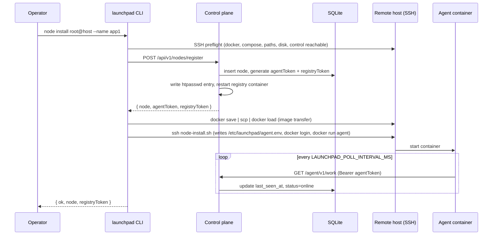
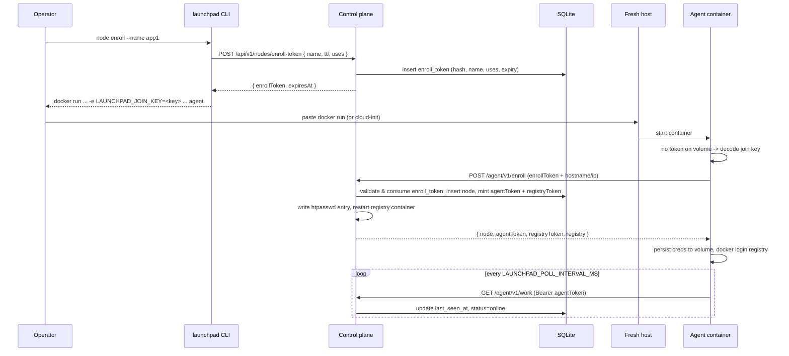
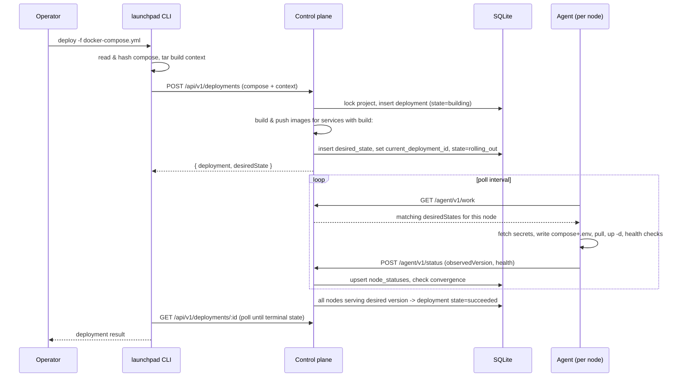
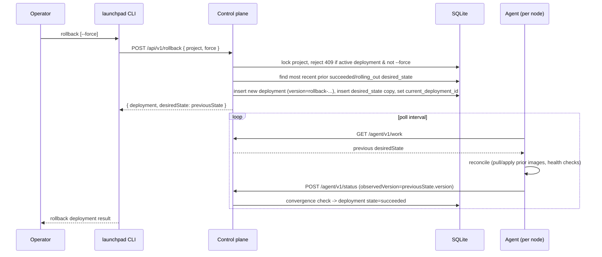

# Pad Launch / Launchpad

A Node.js MVP of the Portable VPS Launch Pad described in `plan.md`.

## Implemented MVP

- Control API with bearer-token auth and SQLite metadata.
- Node registration with per-node agent and registry tokens, via SSH push (`node install`) or self-service pull enrollment (`node enroll` + a single `docker run` on the host).
- Agent pull reconciliation via `/agent/v1/work` and status reporting.
- Compose parsing with `x-launchpad.placement`, build-to-immutable-image desired state, and generated per-node Compose files.
- Optional remote Docker builds on the control host when `launchpad deploy` uploads a source tarball.
- Encrypted-at-rest secrets using an install-time master key, scoped to services assigned to each agent.
- TCP/HTTP/Docker health checks executed by agents after Compose apply.
- Deployment convergence to `succeeded`, project operation locks, cancellation, rollback via a new rollback desired-state record, per-service rollout status/events, and agent-mediated log fetch.
- Secret version tracking with targeted service recreation when only referenced secrets change.
- SSH-based Docker bootstrap helpers with preflight checks for Docker, Compose, writable paths, control reachability, free disk space, and published-port availability.
- `control install` publishes the control API/registry over plain HTTP; front it with your own reverse proxy/TLS termination if exposing it publicly.
- `control.js` can also terminate TLS itself (`LAUNCHPAD_TLS_CERT_FILE` / `LAUNCHPAD_TLS_KEY_FILE`), e.g. a private network with a self-signed cert; point agents at it with `LAUNCHPAD_CONTROL_URL=https://...` and `NODE_EXTRA_CA_CERTS=<path to CA cert>` so the agent's `fetch` trusts it.
- Per-node registry pull tokens are issued at registration and enforced by the registry itself via an htpasswd file that control writes; `node install --registry <host>` performs `docker login` for agents. Tokens can be rotated or revoked with `node:rotate-registry-token` / `node:revoke-registry-token`, which restarts the registry container so the change takes effect immediately.
- Control/local/agent diagnostics via `launchpad doctor`.
- Development `docker-compose.yml` with control API, registry, and optional agent service.

Control-plane backup/restore (SQLite + master key) exists for disaster recovery of the control host itself; per-project data backup/restore is left to the operator (e.g. via their own volume/database tooling).

## Local development

```bash
npm install
npm test
npm run lint

# Unit tests are collocated with source files as src/*.test.js.

docker compose up --build control registry
```

The control service prints and stores the initial operator token in `./data/operator.token` when run directly on the host, or in the `launchpad-data` volume when run in Docker.

## Setup steps

1. **Install the control plane** on a Docker-capable host: `launchpad control install root@control.example.com --token "$LAUNCHPAD_TOKEN" --registry registry.example.com ...`. This builds/ships the Launchpad image over SSH, starts the `control` container, and prints the operator token and control URL. Launchpad does not provision a registry itself — `--registry <host>` is required and must point at a registry you already run. If that registry uses htpasswd auth and you want Launchpad to manage per-node credentials for it, also pass `--registry-auth-path` (the htpasswd file path, mounted into the control container) and `--registry-container` (the registry's container name, restarted whenever credentials change).
2. **Point the CLI at the control plane**: `launchpad init --control-url https://control.example.com --token "$LAUNCHPAD_TOKEN"`. This writes `.launchpad.json` locally so subsequent commands don't need `--control-url`/`--token` repeated.
3. **Set any secrets your services need**: `launchpad secret:set NAME --value ...`. Secrets are encrypted at rest and only released to agents for services that reference them.
4. **Bootstrap each node**, either way:
   - **Push (you have SSH to the host):** `launchpad node install root@app1.example.com --name app1 --control-url https://control.example.com --registry registry.example.com`. This registers the node with the control plane (issuing an agent token and a registry pull token), ships the agent container over SSH, writes `/etc/launchpad/agent.env`, runs `docker login` against the registry, and starts the agent container polling the control plane.
   - **Pull (the host enrolls itself, no SSH):** `launchpad node enroll --name app1` mints a short-lived, single-use enrollment key and prints a ready-to-paste `docker run`. Run that one command on the freshly provisioned host (or drop it into cloud-init/user-data) and the agent exchanges the key for its durable agent + registry tokens on first boot. See [Self-service node enrollment](#self-service-node-enrollment-launchpad-node-enroll).
5. **Deploy a Compose project**: `launchpad deploy -f docker-compose.yml`. The control plane validates placement, optionally builds/pushes images from an uploaded source tarball, and creates a desired-state record.
6. **Wait for convergence**: `launchpad deploy` waits by default (or run `launchpad status` / `launchpad events`) until each agent pulls, applies, and health-checks its services and reports back, at which point the deployment is marked `succeeded`.
7. **Operate**: use `launchpad rollback`, `launchpad restart <service>`, `launchpad logs <service>`, and `launchpad doctor [--nodes]` for day-to-day operations.

## Workflows

### Node bootstrap (`launchpad node install`)



### Self-service node enrollment (`launchpad node enroll`)

A pull-based alternative to `node install`, modeled on how Portainer Edge agents join: the operator never needs SSH to the host. You mint an enrollment key on the control plane first, then run a single self-contained `docker run` on the freshly provisioned host (DigitalOcean droplet, etc.) — or paste it into cloud-init/user-data so the host enrolls itself on first boot. The agent reaches *out* to control, so this works behind NAT/firewalls.

The enrollment key (`LAUNCHPAD_JOIN_KEY`) is base64url-encoded JSON bundling the control URL, a short-lived single-use `enrollToken`, and (optionally, via `--ca`) the control plane's CA certificate. The **durable** agent token is minted by control during enrollment and persisted to the agent's state volume (`/var/lib/launchpad/agent.json`) — it never appears on the `docker run` command line or in `docker inspect`. On container restart the agent loads the persisted token and skips enrollment; on a fresh volume it re-enrolls. A leaked join key is therefore spent on first use and expires on its own.

```bash
# On the operator's machine:
launchpad node enroll --name app1
# prints, e.g.:
#   docker run -d --name launchpad-agent --restart unless-stopped \
#     -v /var/run/docker.sock:/var/run/docker.sock \
#     -v launchpad-agent:/var/lib/launchpad \
#     -e LAUNCHPAD_JOIN_KEY=<key> \
#     ghcr.io/you/launchpad-agent agent
```

Useful flags: `--uses <n>` to let one key enroll several hosts (each self-names from its hostname when `--name` is omitted), `--ttl <seconds>` for the key lifetime (default 1h), `--ca <ca.pem>` to embed a self-signed/private control CA (removes the need to ship `NODE_EXTRA_CA_CERTS` separately), and `--json` for scripting. To keep the key out of shell history / `docker inspect`, mount it and set `LAUNCHPAD_JOIN_KEY_FILE=/path/to/key` instead of `LAUNCHPAD_JOIN_KEY`.



### Deploy (`launchpad deploy`)



### Rollback (`launchpad rollback`)



## SSH bootstrap

The CLI includes pragmatic SSH installers for Docker-capable Linux hosts. They build the local Launchpad image, transfer it with `docker save`/`scp`, and start containers remotely.

```bash
launchpad control install root@control.example.com --token "$LAUNCHPAD_TOKEN" \
  --domain control.example.com --registry-domain registry.example.com --email ops@example.com
launchpad init --control-url https://control.example.com --token "$LAUNCHPAD_TOKEN"
launchpad node install root@app1.example.com --name app1 --address 10.0.0.11 \
  --control-url https://control.example.com --registry registry.example.com
```

These installers assume SSH access and fail early if Docker, Docker Compose, writable Launchpad paths, or node-to-control connectivity are missing. For local/private development only, add `--http-only-dev` to `control install` and `node install` to use HTTP.

For host-mode development:

```bash
npm run start:control
export LAUNCHPAD_TOKEN=$(cat data/operator.token)
node src/cli.js init --control-url http://localhost:8080 --token "$LAUNCHPAD_TOKEN"
node src/cli.js node:register --name dev-node --address 127.0.0.1
```

Start an agent without applying Docker changes:

```bash
export LAUNCHPAD_AGENT_TOKEN=<token from node:register>
export LAUNCHPAD_NODE_NAME=dev-node
export LAUNCHPAD_APPLY=false
npm run start:agent
```

Deploy a Compose project:

```bash
node src/cli.js deploy -f docker-compose.launchpad.yml --no-build-upload
node src/cli.js status
```

Omit `--no-build-upload` to upload the current directory as a build context and let the control process run `docker build` for services with `build:`. In the development compose stack `LAUNCHPAD_PUSH=false` avoids pushing to the local registry; enable it when using a reachable registry. `launchpad deploy` waits for convergence by default; use `--no-wait` to return immediately after creating desired state.

## Docker Compose toolchain

`docker-compose.yml` defines:

- `registry`: local Docker Registry on port `5000`, built from `services/registry` with htpasswd auth enabled (`auth.htpasswd` in `services/registry/config/config.yml`).
- `control`: Launchpad control API on port `8080`, with SQLite/master-key data in a named volume. It also mounts the `registry-auth` volume (`LAUNCHPAD_REGISTRY_AUTH_PATH`) and the host Docker socket so it can write per-node htpasswd entries and restart the registry container (`LAUNCHPAD_REGISTRY_CONTAINER`) whenever a node's registry token is issued, rotated, or revoked.
- `agent`: optional profile service. Run it with `--profile agent` after setting `LAUNCHPAD_AGENT_TOKEN`.

```bash
docker compose up --build control registry
# after registering a node and obtaining the token:
LAUNCHPAD_AGENT_TOKEN=... docker compose --profile agent up agent
```

## Sample app and integration test

`docker-compose.sample.yml` is a three-service sample app using explicit placement:

- `web` on `vps-a`
- `worker` on `vps-b`
- `cache` on `vps-c`

`docker-compose.integration.yml` brings up a local control plane plus three fake VPSes. On macOS/Docker Desktop these fake VPSes are privileged Linux containers, each running its own Docker daemon and Launchpad agent, so the agents apply Compose into isolated Docker environments rather than the host daemon.

Run the full integration test:

```bash
npm run test:integration
```

The test provisions `vps-a`, `vps-b`, and `vps-c`, sets a sample secret, deploys `docker-compose.sample.yml`, waits for all three agents to report the desired version, verifies registry pull-auth (a rotated token authenticates, a wrong password is rejected, and a revoked token is rejected) via `scripts/integration-verify-registry-auth.js`, and then tears the stack down. Set `KEEP_INTEGRATION_STACK=true` to keep containers and volumes for inspection. The integration compose file uses subnet `10.89.240.0/24`; change it if that overlaps with local Docker/VPN networks.

## CLI commands

- `launchpad init`
- `launchpad control install root@host --domain <control-domain> --registry-domain <registry-domain> --email <acme-email>`
- `launchpad node install root@host --name <node> [--address <ip>] --control-url https://control.example.com [--registry registry.example.com]`
- `launchpad node enroll [--name <node>] [--ttl <seconds>] [--uses <n>] [--ca <ca.pem>] [--image <tag>] [--json]`
- `launchpad node:register --name <node> [--address <ip>]`
- `launchpad node:rotate-registry-token <node>`
- `launchpad node:revoke-registry-token <node>`
- `launchpad deploy [-f docker-compose.yml] [--no-build-upload]`
- `launchpad status`
- `launchpad events [--project name]`
- `launchpad doctor [--nodes]`
- `launchpad rollback [--force] [--no-wait] [--timeout 300]`
- `launchpad deploy:cancel DEPLOYMENT_ID`
- `launchpad restart SERVICE`
- `launchpad logs SERVICE [--tail 200]`
- `launchpad secret:set NAME [--value value]`
- `launchpad secret:list`
- `launchpad secret:rm NAME`

## Runtime paths

Agents write generated state under:

```text
/var/lib/launchpad/agent.json                                # durable creds persisted after self-service enrollment
/var/lib/launchpad/projects/<project>/docker-compose.yml
/var/lib/launchpad/projects/<project>/.env
/var/lib/launchpad/projects/<project>/last-applied.json
```

When agents enroll via `node enroll`, mount the state directory as a named volume (`-v launchpad-agent:/var/lib/launchpad`) so `agent.json` survives container recreation and the agent does not need to re-enroll after an image update or reboot.

Set `LAUNCHPAD_STATE_DIR` to change this path during development.
