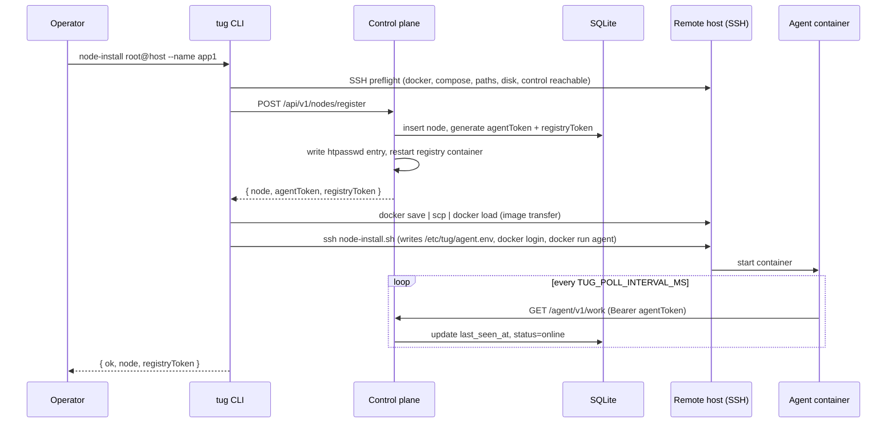
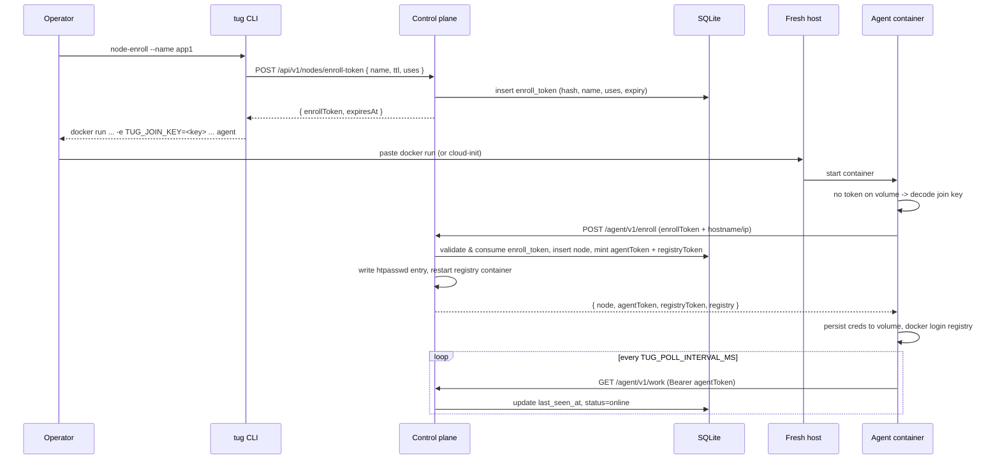
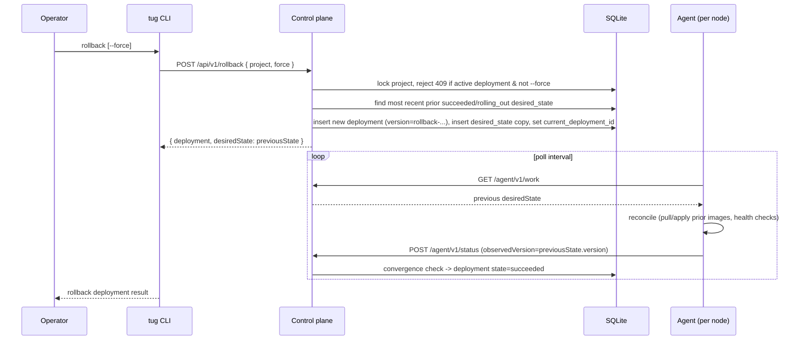
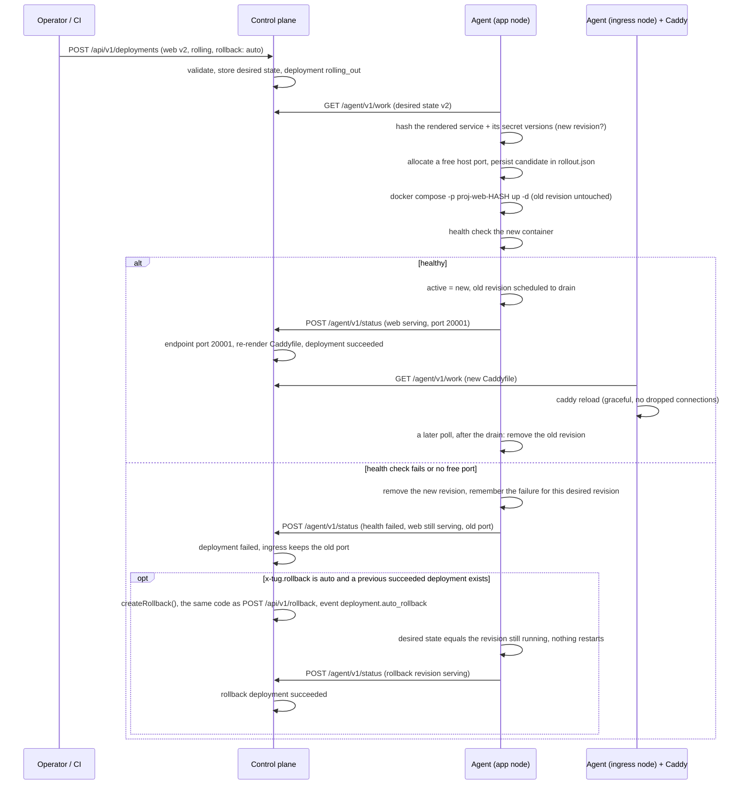

# Architecture

Tug deploys Docker Compose projects to one or more Docker hosts through a small self-hosted control plane and a pull-based agent on each node. SSH is used only to bootstrap hosts; normal deploys go through the control API and the agents.

## Components

- **Control plane** (`src/control.ts`): an Express API backed by SQLite (`tug.db`) and an install-time master key (`master.key`) in `TUG_DATA_DIR`. It stores nodes, projects, deployments, desired states, encrypted secrets, volumes, queued commands, events, hashed API tokens and locks, and builds images from uploaded source tarballs or imports operator-built archives. With no registry configured it stores and serves compressed image artifacts; a configured registry remains supported.
- **Access control** (`src/tokens.ts`): every operator route is declared once in a role table (`read`, `deploy`, `admin`) and passes through one guard that authenticates the bearer (the root operator token or a named API token, both by hash lookup), checks the role and the token's allowed projects, and attaches the acting token name that deployments and audit events record. Agents authenticate separately with per-node tokens. See [Access control](access-control.md).
- **Agent** (`src/agent.ts`): runs on every node, polls `GET /agent/v1/work`, renders a per-node Compose file and `.env`, verifies/downloads/loads artifact-backed images, selectively pulls registry images and runs `docker compose up -d`, executes health checks, runs queued commands and reports back with `POST /agent/v1/status`. Agents only dial out to control, so nodes behind NAT or firewalls work.
- **Rolling rollouts** (`src/rollout.ts`): the agent-side logic for services with `x-tug.rollout.strategy: rolling`: revision hashing, per-revision Compose projects, host port allocation, health-gated takeover, drain and crash recovery. `agent.ts` calls it from `reconcile`.
- **CLI** (`src/cli.ts`): the `tug` command for operators. It talks to the control API and uses SSH only for `control-install` and `node-install`. See [CLI reference](cli.md).
- **Networking** (`src/mesh.ts`, `src/ingress.ts`): optional WireGuard mesh, health-aware service endpoints and the managed Caddy edge. `mesh.ts` has overlay IP allocation, key handling, `wg` config rendering, peer diffing and the idempotent `wg0` reconcile; `ingress.ts` resolves service endpoints and ingress routes, renders the Caddyfile (control) and reconciles the Caddy container (agent). See [Networking](networking.md).
- **Registry**: optional; bring your own to use registry pushes instead of saved-image delivery. Tug can manage per-node pull credentials for a registry that uses an htpasswd file. See [Control plane](control-plane.md#registry).
- **Entrypoint** (`src/main.ts`, `dist/main.js` in the image): one image serves both roles; `node src/main.ts control|agent` or `TUG_ROLE`.
- **Protocol** (`src/protocol.ts`): the control↔agent contract. It holds the types, and a few shared constants such as the active and terminal deployment states, for everything crossing the boundary: `DesiredState`, `ServiceSpec` and `HealthCheck`; the `/agent/v1/*` payloads (`WorkResponse` with its optional `network`, `serviceEndpoints` and `ingress` blocks, `Command` / `CommandResult`, `StatusReport` / `ProjectStatus` / `IngressStatus`, `SecretsResponse`, `WgKeyRequest`); and enrollment (`EnrollRequest` / `EnrollResponse`, `RegisterResponse`, `JoinKey`). `control.ts`, `agent.ts`, `compose.ts` and `cli.ts` all import from it, so change the wire format there first.
- **Injectable agent runners** (`src/runners.ts`): `reconcile`, `executeCommand`, `waitForHealth`, `containerIp` and `pollOnce` take an `AgentContext` (`{ docker, http, nodeName, stateDir, apply, controlUrl, token, host?, mesh?, caddyImage? }`). `docker` is a `DockerRunner` (`createDockerRunner()` wraps `run('docker', …)` from `build.ts`), `host` is a `HostRunner` for `wg` and `ip` (`createHostRunner()`), and `http` is a `fetch`-compatible client. The Caddy reload goes through `docker`. Production code uses `defaultContext()`; `src/agent.test.ts` passes a fake docker runner to unit-test rollout ordering, secret-triggered `--force-recreate` and the docker, tcp and http health-check branches without a Docker daemon. The privileged-Docker integration test remains the end-to-end check.

## Desired state and reconciliation

`tug deploy` sends the Compose file to control, which validates `x-tug` placement (see [Compose extensions](compose.md)), optionally builds images for services with `build:`, and stores an immutable desired-state record for the deployment. Each agent receives the desired states that place services on its node, applies them, and reports the observed display version, immutable desired-state revision and health per project. When every node assigned to the current deployment reports that revision as `serving` (or `skipped`), the deployment becomes `succeeded`; if one reports `failed`, the deployment becomes `failed`.

Deploys, rollbacks, secret changes and data-deleting volume removals take a per-project operation lock, so concurrent operations on one project are rejected with `409`. Long builds renew the project lease and check ownership/cancellation before publication. Deploy publication, rollback and artifact backup/restore share an operation-lifetime writer queue. Rollback creates a new deployment and revision whose desired state copies the most recent earlier `succeeded` or `rolling_out` one. With `x-tug.rollback: auto` control creates that rollback itself when a deployment turns `failed`; see [Rolling rollouts and automatic rollback](#rolling-rollouts-and-automatic-rollback).

Restarts, log fetches, diagnostics and volume deletions are queued as commands for the node that runs the service; the agent picks them up on its next poll and posts results back.

### Events

Agents report lifecycle events to control, and `tug events` shows them next to control's own audit events. An agent does not report that it is still polling: for the recreated services of a project it keeps a fingerprint of the desired revision, the Compose file rendered for its node and the secret versions in its own database (`event_state` in `agent.db`), and sends `service.pulling`, `starting`, `health_checking` and `serving` only when the fingerprint changes. A failed apply produces one `service.failed` event (level `error`, naming the service whose check failed and why) and retries of the same failure stay quiet. When the apply later succeeds the agent sends one `service.serving` event saying it recovered. The agent still applies and health-checks the project on every poll, so drift is repaired the same way; only the events are quiet. Rolling services report their own events when a revision is started, switched or rejected. Control deletes events older than `TUG_EVENT_RETENTION_DAYS` (30) and keeps at most `TUG_EVENT_MAX_ROWS` (100,000); see [Configuration](configuration.md#control-plane).

## Image artifacts

The `builds` table records immutable image references, config-digest identity, platform, archive SHA-256/size and a relative artifact path. Image save/download/hash operations stream bytes; saved archives are validated before import. Build archives finalize before the desired-state transaction becomes current. Failed publication leaves the previous deployment current. `GET /agent/v1/images/:buildId` authenticates the node token and checks the retained service placement; `WorkResponse.retainedImages` protects rollback images from agent pruning.

Docker image stores can expose either a config digest or an OCI index/manifest digest as their local image ID. Artifacts use the saved configuration digest as their canonical identity. After a verified import, agents cache the daemon's actual tag ID paired with that canonical ID and archive hash; they check the tag again before reusing it. This permits classic Docker and containerd-backed Docker to exchange saved images without confusing their different IDs.

Archives are validated before Docker can import them. A containerd-backed `docker save` can list BuildKit build attestations of the image next to it, either nested in the image index or as extra top-level entries. These are accepted only when they carry no image name, their in-toto contents match their digests, and their subject is this exact image; any other extra manifest, extra tag, link, absolute or parent-relative path, or oversized entry rejects the archive.

Local builds use a multipart `POST /api/v1/deployments`: `payload` contains the Compose/project/version and `localImages` descriptors; each descriptor names a corresponding `image-N` file. Each archive must contain exactly its declared Tug tag and actual configuration/platform/checksum. Source contexts and local images are mutually exclusive. Control retags imported images under its own deployment identity before publishing or pushing them.

## Node bootstrap (`tug node-install`)



## Self-service enrollment (`tug node-enroll`)



## Deploy (`tug deploy`)

```mermaid
sequenceDiagram
    participant Op as Operator
    participant CLI as tug CLI
    participant Ctrl as Control plane
    participant DB as SQLite
    participant Agent as Agent (per node)

    Op->>CLI: deploy -f docker-compose.yml
    CLI->>CLI: read & hash compose, tar build context
    CLI->>Ctrl: POST /api/v1/deployments (compose + context)
    Ctrl->>DB: lock project, insert deployment (state=building)
    Ctrl->>Ctrl: build images; save archives or push to configured registry
    Ctrl->>DB: insert desired_state, set current_deployment_id, state=rolling_out
    Ctrl-->>CLI: { deployment, desiredState }
    loop poll interval
        Agent->>Ctrl: GET /agent/v1/work
        Ctrl-->>Agent: matching desiredStates for this node
        Agent->>Agent: fetch secrets, write compose+.env, pull, up -d, health checks
        Agent->>Ctrl: POST /agent/v1/status (observedVersion, observedRevision, health)
        Ctrl->>DB: upsert node_statuses, check convergence
    end
    Ctrl->>DB: all nodes serving desired revision -> deployment state=succeeded
    CLI->>Ctrl: GET /api/v1/deployments/:id (poll until terminal state)
    CLI-->>Op: deployment result
```

## Rollback (`tug rollback`)



## Rolling rollouts and automatic rollback

Services are `recreate` by default: the agent renders the node Compose file and runs `docker compose up -d`, which replaces changed containers in place. A service with `x-tug.rollout.strategy: rolling` is taken out of the node's main project and rolled instead, one changed service at a time:



Rules the agent follows (`src/rollout.ts`):

- A revision is identified by a hash of the rendered service (image id for built images, environment, `extra_hosts`, ports shape, volumes) and the versions of the secrets it references. The same hash means the revision is already running and nothing is restarted; a secret change rolls the service instead of force-recreating it.
- Each revision is Compose project `<project>-<service>-<hash8>` with `--project-directory` set to the main project directory, attached to the main project's `default` network and named volumes as external resources (created if missing), with the single published port remapped to a free port from `TUG_ROLLOUT_PORTS`. The main project keeps only recreated services, so `--remove-orphans` on it never touches a revision.
- State lives in `<state dir>/projects/<project>/rollout.json`: the active revision, a candidate (written before `up`, so a restarted agent resumes the same project and port instead of starting a second one), revisions waiting to drain with their deadline, and the last rejected revision per service so it is not retried on every poll. Drain deadlines are checked on every poll, so a drain never blocks the poll loop.
- A failed health check, an exhausted port range or a failed start removes the candidate and leaves the active revision untouched. The node reports `health: failed` and the rejection reason, while the service state stays `serving` with the old port so control keeps routing to it. If a recreated service of the same project fails, rolling services keep being reported serving the same way.
- Control resolves each endpoint's `port` from the service state, so the ingress follows takeovers without any ingress-specific agent protocol. Convergence is unchanged: `failed` still comes from a node reporting failed health for the current revision.
- Automatic rollback runs on control right after the status update that moved a deployment from `rolling_out` to `failed`. `scheduleAutoRollback` works in the background so a busy writer queue never blocks status reports, skips rollback deployments (their versions start with the reserved `rollback-`), requires the failed deployment to still be current, and takes the writer queue and project lock like a manual rollback. On a rolling node the previous revision is still running, so applying the rollback restarts nothing; other nodes recreate as usual.

## Networking

With `TUG_MESH=true`, `GET /agent/v1/work` also returns a `network` block (this node's overlay IP and every other node's WireGuard peer), `serviceEndpoints` (serving endpoints per service for injecting `extra_hosts`) and, for nodes marked as ingress nodes, an `ingress` block with the rendered Caddyfile. Agents report their public key with `POST /agent/v1/wireguard/key` (or `wgPublicKey` at enrollment) and ingress state in the status report. Control stores overlay IPs in `nodes.overlay_ip` and keys in `wg_peers`. See [Networking](networking.md) for the model and the mesh/ingress sequence diagram.

## Secrets

Secrets are encrypted at rest with AES-256-GCM using the control master key, and versioned per project. An agent only receives the secrets referenced by the `environment` of services placed on its node, written to the project's `.env` with mode `0600`. When only a referenced secret's version changes, the agent force-recreates just the affected services.

## Runtime paths

Agents write generated state under `TUG_STATE_DIR` (default `/var/lib/tug`):

```text
/var/lib/tug/agent.json                                # durable creds persisted after self-service enrollment
/var/lib/tug/agent.db                                  # last applied version/revision and secret versions per project
/var/lib/tug/managed-images.json                       # only Tug-owned image references eligible for conservative pruning
/var/lib/tug/image-identities.json                     # canonical artifact identities paired with daemon-local tag IDs
/var/lib/tug/wireguard/private.key                     # mesh only: node's WireGuard private key (0600), never sent to control
/var/lib/tug/wireguard/wg0.conf                        # mesh only: last config passed to `wg syncconf`
/var/lib/tug/ingress/                                  # ingress nodes only: applied Caddy config and its hash
/var/lib/tug/projects/<project>/docker-compose.yml
/var/lib/tug/projects/<project>/.env
/var/lib/tug/projects/<project>/rollout.json               # rolling services: active/candidate/draining revisions and the last rejected one
/var/lib/tug/projects/<project>/rollout/<revision>.yml     # rolling services: Compose file of each running revision
```

When agents enroll via `node-enroll`, mount the state directory as a named volume (`-v tug-agent:/var/lib/tug`) so `agent.json` survives container recreation and the agent does not re-enroll after an image update or reboot.
