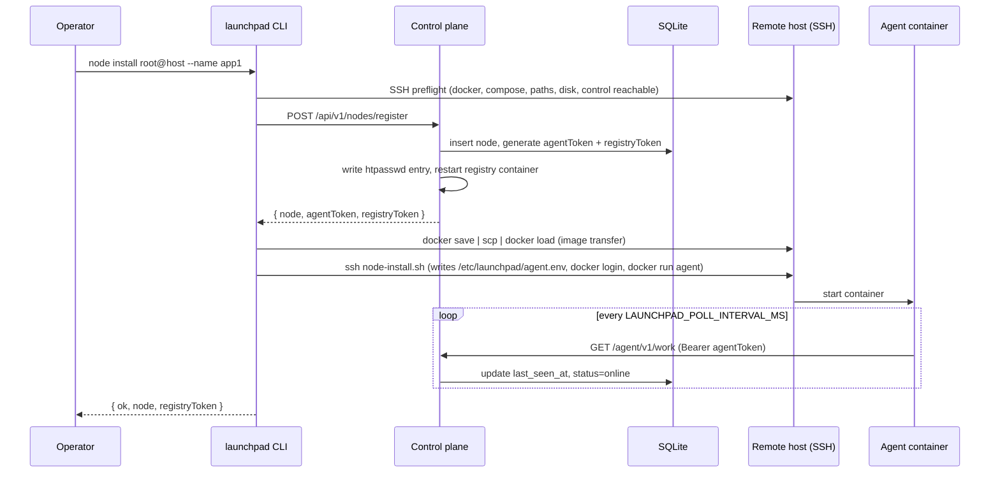
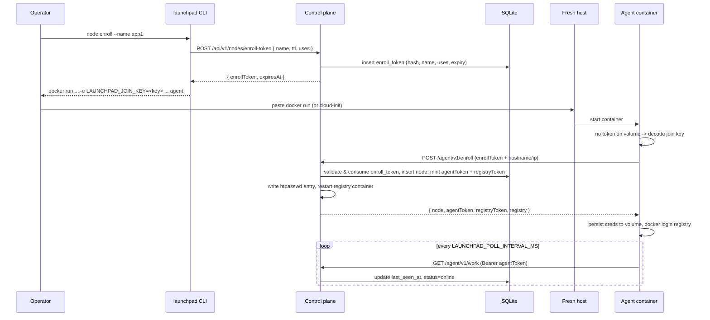
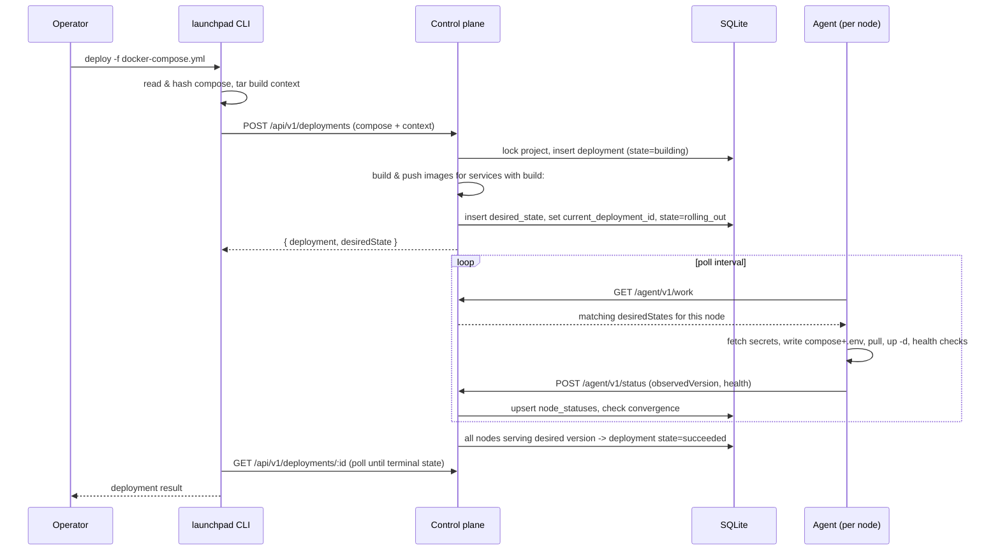

# Architecture

Launchpad deploys Docker Compose projects to one or more Docker hosts through a small self-hosted control plane and a pull-based agent on each node. SSH is used only to bootstrap hosts; normal deploys go through the control API and the agents.

## Components

- **Control plane** (`src/control.ts`): an Express API backed by SQLite (`launchpad.db`) and an install-time master key (`master.key`) in `LAUNCHPAD_DATA_DIR`. It stores nodes, projects, deployments, desired states, encrypted secrets, volumes, queued commands, events and locks, and optionally builds and pushes images from uploaded source tarballs.
- **Agent** (`src/agent.ts`): runs on every node, polls `GET /agent/v1/work`, renders a per-node Compose file and `.env`, runs `docker compose pull` / `up -d`, executes health checks, runs queued commands and reports back with `POST /agent/v1/status`. Agents only dial out to control, so nodes behind NAT or firewalls work.
- **CLI** (`src/cli.ts`): the `launchpad` command for operators. It talks to the control API and uses SSH only for `control install` and `node install`. See [CLI reference](cli.md).
- **Networking** (`src/mesh.ts`, `src/ingress.ts`): optional WireGuard mesh, health-aware service endpoints and the managed Caddy edge. `mesh.ts` has overlay IP allocation, key handling, `wg` config rendering, peer diffing and the idempotent `wg0` reconcile; `ingress.ts` resolves service endpoints and ingress routes, renders the Caddyfile (control) and reconciles the Caddy container (agent). See [Networking](networking.md).
- **Registry**: bring your own. Launchpad can manage per-node pull credentials for a registry that uses an htpasswd file. See [Control plane](control-plane.md#registry).
- **Entrypoint** (`src/main.ts`, `dist/main.js` in the image): one image serves both roles; `node src/main.ts control|agent` or `LAUNCHPAD_ROLE`.
- **Protocol** (`src/protocol.ts`): the control↔agent contract. It holds the types, and a few shared constants such as the active and terminal deployment states, for everything crossing the boundary: `DesiredState`, `ServiceSpec` and `HealthCheck`; the `/agent/v1/*` payloads (`WorkResponse` with its optional `network`, `serviceEndpoints` and `ingress` blocks, `Command` / `CommandResult`, `StatusReport` / `ProjectStatus` / `IngressStatus`, `SecretsResponse`, `WgKeyRequest`); and enrollment (`EnrollRequest` / `EnrollResponse`, `RegisterResponse`, `JoinKey`). `control.ts`, `agent.ts`, `compose.ts` and `cli.ts` all import from it, so change the wire format there first.
- **Injectable agent runners** (`src/runners.ts`): `reconcile`, `executeCommand`, `waitForHealth`, `containerIp` and `pollOnce` take an `AgentContext` (`{ docker, http, nodeName, stateDir, apply, controlUrl, token, host?, mesh?, caddyImage? }`). `docker` is a `DockerRunner` (`createDockerRunner()` wraps `run('docker', …)` from `build.ts`), `host` is a `HostRunner` for `wg` and `ip` (`createHostRunner()`), and `http` is a `fetch`-compatible client. The Caddy reload goes through `docker`. Production code uses `defaultContext()`; `src/agent.test.ts` passes a fake docker runner to unit-test rollout ordering, secret-triggered `--force-recreate` and the docker, tcp and http health-check branches without a Docker daemon. The privileged-Docker integration test remains the end-to-end check.

## Desired state and reconciliation

`launchpad deploy` sends the Compose file to control, which validates `x-launchpad` placement (see [Compose extensions](compose.md)), optionally builds images for services with `build:`, and stores an immutable desired-state record for the deployment. Each agent receives the desired states that place services on its node, applies them, and reports the observed version and health per project. When every node assigned to the current deployment reports that version as `serving` (or `skipped`), the deployment becomes `succeeded`; if one reports `failed`, the deployment becomes `failed`.

Deploys, rollbacks, secret changes and data-deleting volume removals take a per-project operation lock, so concurrent operations on one project are rejected with `409`. Rollback creates a new deployment whose desired state copies the most recent earlier `succeeded` or `rolling_out` one.

Restarts, log fetches, diagnostics and volume deletions are queued as commands for the node that runs the service; the agent picks them up on its next poll and posts results back.

## Node bootstrap (`launchpad node install`)



## Self-service enrollment (`launchpad node enroll`)



## Deploy (`launchpad deploy`)



## Rollback (`launchpad rollback`)


## Networking

With `LAUNCHPAD_MESH=true`, `GET /agent/v1/work` also returns a `network` block (this node's overlay IP and every other node's WireGuard peer), `serviceEndpoints` (serving endpoints per service for injecting `extra_hosts`) and, for nodes marked as ingress nodes, an `ingress` block with the rendered Caddyfile. Agents report their public key with `POST /agent/v1/wireguard/key` (or `wgPublicKey` at enrollment) and ingress state in the status report. Control stores overlay IPs in `nodes.overlay_ip` and keys in `wg_peers`. See [Networking](networking.md) for the model and the mesh/ingress sequence diagram.

## Secrets

Secrets are encrypted at rest with AES-256-GCM using the control master key, and versioned per project. An agent only receives the secrets referenced by the `environment` of services placed on its node, written to the project's `.env` with mode `0600`. When only a referenced secret's version changes, the agent force-recreates just the affected services.

## Runtime paths

Agents write generated state under `LAUNCHPAD_STATE_DIR` (default `/var/lib/launchpad`):

```text
/var/lib/launchpad/agent.json                                # durable creds persisted after self-service enrollment
/var/lib/launchpad/agent.db                                  # last applied version and secret versions per project
/var/lib/launchpad/wireguard/private.key                     # mesh only: node's WireGuard private key (0600), never sent to control
/var/lib/launchpad/wireguard/wg0.conf                        # mesh only: last config passed to `wg syncconf`
/var/lib/launchpad/ingress/                                  # ingress nodes only: applied Caddy config and its hash
/var/lib/launchpad/projects/<project>/docker-compose.yml
/var/lib/launchpad/projects/<project>/.env
```

When agents enroll via `node enroll`, mount the state directory as a named volume (`-v launchpad-agent:/var/lib/launchpad`) so `agent.json` survives container recreation and the agent does not re-enroll after an image update or reboot.
