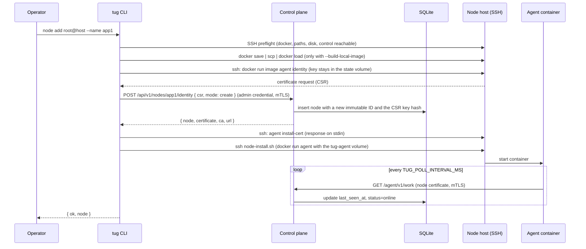
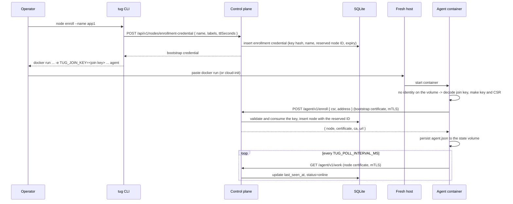
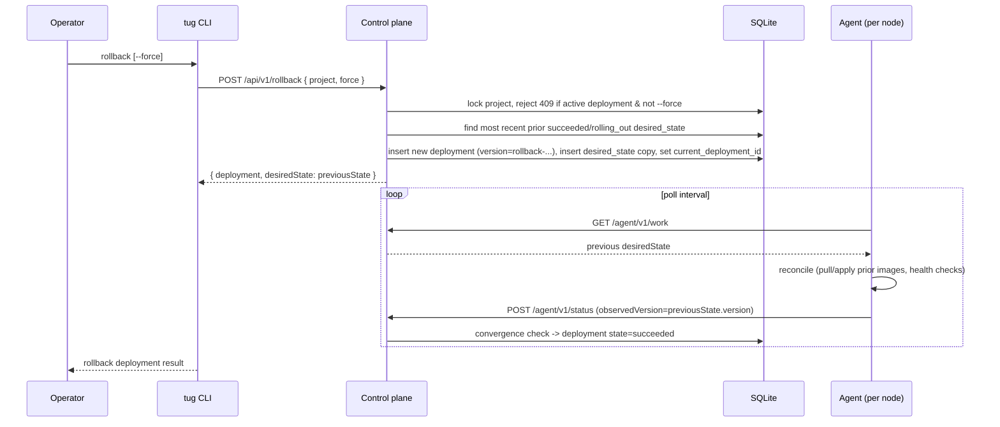

# Architecture

Tug deploys Docker Compose applications to one or more Docker hosts through a small self-hosted control plane and a pull-based agent on each node. The agents drive each node's Docker Engine API directly; Compose is used only on the operator machine to normalize the file. SSH is used only to install the control plane and nodes; normal deploys go through the control API and the agents, which share one mutual-TLS port. [Terminology](terminology.md) defines the vocabulary used here.

## Components

The [README](../README.md#how-it-fits-together) has an overview diagram of how these fit together.

- **Control plane** (`src/control/control.ts`): an Express API behind a single TLS 1.3 listener that requires a client certificate ([Control plane](control-plane.md#authentication-and-pki)), backed by SQLite (`tug.db`), an install-time master key (`master.key`) and the private CA (`pki/`) in `TUG_DATA_DIR`. It stores nodes, projects, deployments, desired states, encrypted secrets, volumes, queued commands, events, operator and enrollment credentials (public-key hashes, never private keys) and locks, and builds images from uploaded source tarballs or imports operator-built archives. It always stores and serves built images as compressed artifacts and resolves published image tags to immutable registry digests before publication.
- **Access control** (`src/control/credentials.ts`, `src/pki.ts`): every peer presents a certificate signed by control's CA. The certificate names one principal (`tug:operator:<id>`, `tug:node:<id>` or `tug:enroll:<id>`) and control authorizes it by comparing the certificate's public-key hash with the key stored for that principal. Every operator route is declared once in a role table (`read`, `deploy`, `admin`) and passes through one guard that checks the role and the credential's allowed projects, and attaches the acting credential name that deployments and audit events record. Agent routes derive the node from the certificate and touch only that node's objects. See [Access control](access-control.md).
- **Agent** (`src/agent/agent.ts`): runs on every node, fetches authoritative work from `GET /agent/v1/work` and reconciles containers through the Docker Engine API (`src/docker-api.ts`) over the local socket. It builds one container definition per placed service (`src/container-spec.ts`), substitutes released secrets into the container environment, verifies/downloads/loads artifact-backed images, pulls published images by their pinned registry digest when the desired revision is new to the node, executes health checks, and reports status. Nodes need only the Docker Engine, not the Compose plugin.
- **Reconciler** (`src/agent/reconciler.ts`): one loop for every service. Containers carry `tug.project`, `tug.service`, `tug.revision` and `tug.config-hash` labels; the hash covers the resolved definition, the image identity and the versions of the secrets the service uses, and a container whose hash differs is replaced. `recreate` stops the old container and starts the new one; `rolling` (`x-tug.rollout.strategy: rolling`) starts the new one on a free host port beside the old one, health-checks it, lets the ingress switch and removes the old one after a drain. Tug names its own network `tug_<project>`, volumes `tug_v<project-length>_<project>_<volume>` and containers `tug-<project>-<service>-<hash8>`; service names are network aliases. Reconciliation never removes volumes; `volume.delete` is the only way one goes away.
- **Compose normalization** (`src/compose/normalize.ts`): `tug deploy` reads the Compose file on the operator machine with Tug's own reader (`src/compose/load.ts`), without Docker or the Compose plugin: interpolation from the environment and `.env`, `env_file`, `extends`, profiles, and the expansion of short syntax into the long form. A file that uses something the reader does not implement (`include`, `!reset` and `!override` tags) is rejected with a pointer to `tug deploy --compose-cli`, which renders it with `docker compose config` instead. Control secrets are interpolated as `@@tug:secret:NAME@@` sentinels that the agent replaces with released values. Control validates the result against an allowlist of keys ([Compose](compose.md#supported-keys)); agents never parse Compose YAML.
- **CLI** (`src/cli.ts`): the `tug` command for operators. It talks to the control API and uses SSH only for `control setup` and `node add`. See [CLI reference](cli.md).
- **Networking** (`src/ingress.ts`, `src/node-address.ts`): health-aware service endpoints, private-address port binding and the managed Caddy edge. `ingress.ts` resolves service endpoints and ingress routes from each node's `address`, renders the Caddyfile (control) and reconciles the Caddy container (agent). Tug provides no overlay or tunnel; the operator owns the inter-node network. See [Networking](networking.md).
- **Runtime entrypoint** (`src/main.ts`, installed as the `tug-runtime` binary and `dist/main.js` in the image): one image runs both control and agent; `node src/main.ts control|agent` or `TUG_ROLE`. It also provides the `agent identity` and `agent install-cert` subcommands that node installation uses.
- **Protocol** (`src/protocol.ts`): the control↔agent contract. It holds the types, and a few shared constants such as the active and terminal deployment states, for everything crossing the boundary: `DesiredState`, `ServiceSpec` and `HealthCheck`; the `/agent/v1/*` payloads (`WorkResponse` with its optional `serviceEndpoints`, `ports` and `ingress` blocks, `Command` / `CommandResult`, `StatusReport` / `ProjectStatus` / `IngressStatus`, `StreamMessage`, `WakeResponse`, `SecretsResponse`); and identity and enrollment (`IdentityRequest` / `IdentityResponse`, `EnrollRequest` / `EnrollResponse`, `RenewRequest` / `RenewResponse`, `EnrollmentCredentialResponse`, `JoinKey`). `control.ts`, `agent.ts`, `compose.ts` and `cli.ts` all import from it, so change the wire format there first.
- **Injectable agent runners** (`src/agent/agent.ts`, `src/agent/runners.ts`): `reconcile`, `executeCommand`, `waitForHealth`, `containerIp` and `pollOnce` take an `AgentContext` (`{ docker, http, nodeName, stateDir, apply, controlUrl, credential?, caddyImage?, rolloutPorts? }`). `docker` is a `DockerApi` (the real `DockerEngine` talks to the Engine API over the local socket, `tests/fake-docker.ts` implements it in memory), and `http` is a `fetch`-compatible client pinned to the node's credential. Production code uses `defaultContext()`; the agent tests pass the in-memory Docker fake to unit-test rollout ordering, secret-triggered recreation and the docker, tcp and http health-check branches without a Docker daemon. The privileged-Docker integration test remains the end-to-end check.

## Source layout

`src/` is organized by runtime role, because the CLI, the control plane and the agent run on different machines and must not grow into one another. Three role folders each hold the code only that role runs, four domain folders hold code several roles use, and the files left at the top are small single-purpose modules.

| Path | Contents |
| --- | --- |
| `cli.ts`, `main.ts` | The two entry points (`tug` and `tug-runtime`), kept at the root so `dist/cli.js` and `dist/main.js` do not move. |
| `cli/` | The operator CLI: `commands/` (one file per command group) and the prompt, progress, picker, config, install and live-session helpers, named without a `cli-` prefix. |
| `control/` | The control plane: the API, credentials and the role table, secrets, TLS listener, status-report validation and node diagnostics. |
| `agent/` | The node agent: the reconcile loop, agent identity, jobs, live sessions and the injectable runners. |
| `db/` | SQLite driver contract, node driver, migrations, transactions, project locks, row ids and the lifecycle tables and writers. |
| `backup/` | Backup config, destinations and their encrypted storage, the scheduler and restore (control), the backup job (agent), cron parsing and the CLI-side check. |
| `images/` | Image references and defaults, registry credentials and digests, source builds, archives and artifacts. |
| `compose/` | Compose validation and desired-state building, the native Compose reader (with the optional `docker compose config` path) and the `x-tug` editor schema. |
| `protocol.ts`, `pki.ts`, `transport.ts`, `roles.ts` | The wire contract, certificates and identities, the pinned mTLS client and the credential roles and name patterns. |
| `docker-api.ts`, `container-spec.ts`, `ingress.ts`, `node-address.ts` | The Docker Engine client, container definitions, the Caddy edge and node address validation. |
| `files.ts`, `errors.ts`, `duration.ts` | Small helpers named for what they do. There is no `util` file: a new helper goes in the domain that uses it or in a file named for its concern. |

The rule is that `cli/`, `control/` and `agent/` may import domain modules and themselves but never one another, and domain modules never import a role. `cli.ts` imports no other role and `main.ts` imports no CLI code. Runtime imports (everything except `import type`) contain no cycles. `src/architecture.test.ts` enforces this, including dynamic `import()` calls, and also fails when a new top-level folder appears, so a catch-all folder cannot creep in. Unit tests sit next to the module they test; tests that span modules (`docs.examples`, `package`, `main`) stay at the top.

## Desired state and reconciliation

`tug deploy` sends the Compose file to control, which validates `x-tug` placement (see [Compose extensions](compose.md)), optionally builds images for services with `build:`, and stores an immutable desired-state record for the deployment. Each agent receives the desired states that place services on its node, applies them, and reports the observed display version, immutable desired-state revision and health per project. When every assigned node reports the current revision as `serving` (or `skipped`), control also waits for every enabled managed-ingress node to report the current routing configuration as applied when the project adds, changes or removes ingress routes. The acknowledged configuration must contain each current project route with a serving upstream, or marked `maintenance`, which is routed with no upstream on purpose; a failed, stale or older ingress report cannot complete deployment. With no enabled ingress node, convergence reports service health only. This acknowledgement confirms the agent applied its Caddy configuration, not external DNS, certificate issuance or a successful public request. A failed node report still fails the deployment with its apply and rollout errors; an unavailable ingress can leave the deployment `rolling_out` until it recovers or the CLI times out.

Deploys, rollbacks, secret changes and data-deleting volume removals take a per-project operation lock, so concurrent operations on one project are rejected with `409`. Long builds renew the project lease and check ownership/cancellation before publication. Deploy publication, rollback and artifact backup/restore share an operation-lifetime writer queue. Rollback creates a new deployment and revision whose desired state copies the most recent earlier `succeeded` or `rolling_out` one. With `x-tug.rollback: auto` control creates that rollback itself when a deployment turns `failed`; see [Rolling rollouts and automatic rollback](#rolling-rollouts-and-automatic-rollback).

Restarts, log fetches, diagnostics and volume deletions are queued as commands for the node that runs the service; control wakes that node, and the agent fetches the command and posts its result back.

### Agent wake channel

After each reconciliation, the agent waits on `GET /agent/v1/stream`, a WebSocket upgrade authenticated by the same node certificate as the HTTP agent API. Control sends a `work-available` hint for durable work; desired state and queued commands remain in SQLite and the agent always fetches them through `GET /agent/v1/work`. Deployments, rollbacks, secret changes and cluster-wide network changes wake every node because they can change placement, service endpoints or ingress. Node commands and ingress-role changes wake only their target node.

The same socket carries ephemeral live operations. The CLI opens `GET /api/v1/live` with its operator credential, sends one versioned request, and control resolves the project, service and optional node before binding the session to that exact connected agent. For a rolling service, the agent addresses the active rollout container instead of the Compose service container. `exec` (with a PTY when asked), `tug run` one-off containers, `logs -f`, `ps` and `inspect` stream responses directly; input, cancellation and disconnect cleanup travel in the other direction. Live requests are never persisted, queued or replayed, all three hops enforce frame, buffer and session limits, and losing any socket closes the session and kills the agent's local Docker client process. Docker does not expose the remote exec process identity through this client stream, so an already-started process inside the container may continue after cancellation or disconnect; do not treat client cancellation as remote process termination. `inspect` is deliberately a `deploy` operation and redacts environment values; it does not limit what a deploy credential can read through `exec`.

If a proxy or firewall rejects WebSockets, the agent uses `GET /agent/v1/wake?after=<cursor>&timeout=<milliseconds>` for durable work only. Each node has a monotonic in-memory wake cursor, so a wake issued just before the long poll begins is returned immediately instead of being lost. Cursors and sockets are intentionally ephemeral: control restart merely loses a hint, while periodic `TUG_POLL_INTERVAL_MS` reconciliation remains the correctness and drift-repair path. Live operations require the WebSocket path because replaying them through long-poll would be unsafe.

### Events

Agents report lifecycle events to control, and `tug events` shows them next to control's own audit events. An agent does not report that it is still reconciling: for the recreated services of a project it keeps a fingerprint of the desired revision, the Compose file rendered for its node and the secret versions in its own database (`event_state` in `agent.db`), and sends `service.pulling`, `starting`, `health_checking` and `serving` only when the fingerprint changes. A failed apply produces one `service.failed` event (level `error`, naming the service whose check failed and why) and retries of the same failure stay quiet. When the apply later succeeds the agent sends one `service.serving` event saying it recovered. The agent still applies and health-checks the project after every wake or poll, so drift is repaired the same way; only the events are quiet. Rolling services report their own events when a revision is started, switched or rejected. Control deletes events older than `TUG_EVENT_RETENTION_DAYS` (30) and keeps at most `TUG_EVENT_MAX_ROWS` (100,000); see [Configuration](configuration.md#control-plane).

## SQLite storage

Control metadata and agent applied/event state use Node's built-in synchronous SQLite driver. `src/db/driver.ts` owns the runtime-neutral `Db` contract, binding values and unique/busy error categories; `src/db/node.ts` alone imports `node:sqlite`. Queries return ordinary objects, missing rows are `undefined`, `all<Row>()` returns `Row[]`, and writes expose numeric change counts. Only anonymous `?` parameters are supported, with strict arity and value validation. Integer reads use numbers and reject unsafe values. Unexpected driver failures propagate with their original identity; classified errors preserve the driver error as their cause.

`src/db/db.ts` selects one connection factory for control, agents and restore snapshots. Writable connections enable WAL, foreign keys and a 1,000 ms busy timeout; initialization closes the connection on failure. Read-only snapshots require an existing file and run no schema creation or journal-mode change. Control and agent databases carry a schema version (`PRAGMA user_version`) and ordered, append-only migration steps (`src/db/migrate.ts`, `src/db/db.ts`): a new database is created at the latest version, an older one is upgraded in place (each step in its own transaction, after copying a database that holds data to `<file>.pre-v<N>.bak`), and a database from a newer Tug is refused untouched, including as a restore snapshot. Deployment publication executes synchronously from `BEGIN IMMEDIATE` through commit or rollback; writer queues and project leases coordinate workflows that also await files, Docker or network operations.

`src/db/locks.ts` owns control’s project-lock queries, and `src/backup/destination-store.ts` owns destination and encrypted credential storage shared by control and the backup scheduler. Keep HTTP responses, lease timers, encryption, audit events and wake notifications in their callers. These focused modules use parameterized SQL directly; row interfaces remain manually maintained and do not validate SQL projections. Other query families remain in their existing callers for later extraction.

`src/db/transaction.ts` provides `immediateTransaction()` for synchronous database-only work: it begins an immediate transaction, returns the callback result after commit and rolls back on callback or commit failure without masking the original error. Callbacks must not start asynchronous work; promise-like results are rejected as a defensive check, which cannot cancel work already started. Nested transactions are rejected, and a failed begin never rolls back the existing transaction. Destination replacement and removal commit configuration and credentials together; deployment publication uses the same helper.

SQL executes on the owning process's event loop. Busy waits, snapshots and integrity checks can pause APIs, WebSocket traffic and timers; backup blocking is described in [Control plane](control-plane.md#backup-and-restore). Database-only work does not return promises. Filesystem preparation and other asynchronous workflows retain their asynchronous interfaces.

A Bun bundle of control or agent code needs no separate adapter today: Bun 1.4.4 implements `node:sqlite`, including the `errcode` values this adapter classifies, so the same module runs unchanged. If that ever stops holding, a `bun:sqlite` adapter can be supplied through the same factory, selected at build time, with the same factory-driven database contract tests. The CLI-only executable does not access SQLite. Hosting control on Bun is blocked elsewhere, by the missing peer certificate on HTTPS request sockets, and has a possible route through a raw TLS listener ([Standalone binary](standalone-binary.md#peer-certificate-under-bun)).

## Lifecycles

Five lifecycles are stored as a `state` column and are declared in `src/db/lifecycles.ts` as transition tables: `from: [possible next states]`. `src/db/lifecycle.ts` holds the only code that writes those columns after insert. `advance` and `advanceWhere` refuse a transition the table does not declare (a programming error that throws) and apply a legal one as `UPDATE ... WHERE state IN (from)`, so two writers racing for the same row cannot both win and the loser learns it from the change count. The baseline schema generates a `CHECK` constraint on each state column from the same table, so an undeclared state is rejected at insert in a database created by this release. Tables created by an earlier release keep the definition they were created with (SQLite cannot add a `CHECK` to an existing column), so an upgraded database relies on the guarded writer alone. Tests check that every target is a declared state and that every state is reachable, so a state that nothing writes cannot be declared.

| Lifecycle | States |
| --- | --- |
| Deployment | `building → rolling_out → succeeded`, with `build_failed`, `failed` and `cancelled` as the other exits. A rollback is inserted already `rolling_out`. |
| Command | `pending → running → succeeded \| failed`, plus `pending → expired` (past its deadline, never delivered late) and `pending → cancelled`. |
| Backup run | `queued → running → succeeded \| failed`, plus `queued → missed`. Runs that never reached a node are inserted as `missed` or `cancelled`. |
| Restore | `locking → holding → safety_backup → restoring → verifying → succeeded` for in-place restores; scratch restores go straight to `restoring`. `failed` before any data changed, `interrupted` after, then `restoring` again (`restore resume`) or `released`. |
| Build | `building → complete → pruned`, or `building → failed` when the deployment's build failed or control restarted mid-build. |

A node's status is not a stored lifecycle. The column records `registered`, `online` or `disabled`, and `stale` is derived from `last_seen_at` by `nodeStatus` on every read, so it never lags behind the clock.

## Image artifacts

The `builds` table records immutable image references, config-digest identity, platform, archive SHA-256/size and a relative artifact path. Image save/download/hash operations stream bytes; saved archives are validated before import. Build archives finalize before the desired-state transaction becomes current. Failed publication leaves the previous deployment current. `GET /agent/v1/images/:buildId` authenticates the node certificate and checks the retained service placement; `WorkResponse.retainedImages` protects rollback images from agent pruning.

Docker image stores can expose either a config digest or an OCI index/manifest digest as their local image ID. Artifacts use the saved configuration digest as their canonical identity. After a verified import, agents cache the daemon's actual tag ID paired with that canonical ID and archive hash; they check the tag again before reusing it. This permits classic Docker and containerd-backed Docker to exchange saved images without confusing their different IDs.

Archives are validated before Docker can import them. A containerd-backed `docker save` can list BuildKit build attestations of the image next to it, either nested in the image index or as extra top-level entries. These are accepted only when they carry no image name, their in-toto contents match their digests, and their subject is this exact image; any other extra manifest, extra tag, link, absolute or parent-relative path, or oversized entry rejects the archive.

Local builds use a multipart `POST /api/v1/deployments`: `payload` contains the Compose/project/version and `localImages` descriptors; each descriptor names a corresponding `image-N` file. Each archive must contain exactly its declared Tug tag and actual configuration/platform/checksum. Source contexts and local images are mutually exclusive. Control retags imported images under its own deployment identity before publishing their saved archives.

## Node installation (`tug node add`)

The node makes its own key and certificate request, so no bootstrap secret travels and the private key never leaves the host. The operator's admin credential authorizes the identity at that moment.



`node replace` and `node repair` run the same flow with `mode: replace` (and, for repair, move corrupt credential documents aside first). See [Nodes](nodes.md).

## Self-service enrollment (`tug node enroll`)



The bootstrap certificate reaches only `POST /agent/v1/enroll`. A retry with the same key signs another certificate for the same node without changing stored values.

## Deploy (`tug deploy`)

```mermaid
sequenceDiagram
    participant Op as Operator
    participant CLI as tug CLI
    participant Ctrl as Control plane
    participant DB as SQLite
    participant Agent as Agent (per node)

    Op->>CLI: deploy -f docker-compose.yml
    CLI->>CLI: read & hash compose, tar build context
    CLI->>Ctrl: POST /api/v1/deployments (compose + context)
    Ctrl->>DB: lock project, insert deployment (state=building)
    Ctrl->>Ctrl: build images; save archives; pin published image digests
    Ctrl->>DB: insert desired_state, set current_deployment_id, state=rolling_out
    Ctrl-->>CLI: { deployment, desiredState }
    loop poll interval
        Agent->>Ctrl: GET /agent/v1/work
        Ctrl-->>Agent: matching desiredStates for this node
        Agent->>Agent: fetch secrets, pull or load images, recreate containers whose config hash changed, health checks
        Agent->>Ctrl: POST /agent/v1/status (observedVersion, observedRevision, health)
        Ctrl->>DB: upsert node_statuses, check convergence
    end
    Ctrl->>DB: all nodes serving desired revision -> deployment state=succeeded
    CLI->>Ctrl: GET /api/v1/deployments/:id (poll until terminal state)
    CLI-->>Op: deployment result
```

## Rollback (`tug rollback`)



## Rolling rollouts and automatic rollback

Services are `recreate` by default: a container whose config hash changed is stopped and replaced in place. A service with `x-tug.rollout.strategy: rolling` is rolled instead, one changed service at a time:

```mermaid
sequenceDiagram
    participant Op as Operator / CI
    participant Ctrl as Control plane
    participant A as Agent (app node)
    participant E as Agent (ingress node) + Caddy

    Op->>Ctrl: POST /api/v1/deployments (web v2, rolling, rollback: auto)
    Ctrl->>Ctrl: validate, store desired state, deployment rolling_out
    A->>Ctrl: GET /agent/v1/work (desired state v2)
    A->>A: hash the rendered service + its secret versions (new revision?)
    A->>A: allocate a free host port, persist candidate in rollout.json
    A->>A: create and start container tug-proj-web-HASH via the Engine API (old revision untouched)
    A->>A: health check the new container
    alt healthy
        A->>A: active = new, old revision scheduled to drain
        A->>Ctrl: POST /agent/v1/status (web serving, port 20001)
        Ctrl->>Ctrl: endpoint port 20001, re-render Caddyfile; deployment still rolling_out
        E->>Ctrl: GET /agent/v1/work (new Caddyfile)
        E->>E: caddy reload (graceful, no dropped connections)
        E->>Ctrl: report applied configuration hash
        Ctrl->>Ctrl: matching ingress acknowledged -> deployment succeeded
        A->>A: a later poll, after the drain: remove the old revision
    else health check fails or no free port
        A->>A: remove the new revision, remember the failure for this desired revision
        A->>Ctrl: POST /agent/v1/status (health failed, web still serving, old port)
        Ctrl->>Ctrl: deployment failed, ingress keeps the old port
        opt x-tug.rollback is auto and a previous succeeded deployment exists
            Ctrl->>Ctrl: createRollback(), the same code as POST /api/v1/rollback, event deployment.auto_rollback
            A->>A: desired state equals the revision still running, nothing restarts
            A->>Ctrl: POST /agent/v1/status (rollback revision serving)
            Ctrl->>Ctrl: rollback deployment succeeded
        end
    end
```

How this meets the managed Caddy: the ingress switches by reload when the new revision's port is reported, and the old revision stays up for `drain` (default 30s), so no request depends on Caddy's retry window during a rolling switch. That window (`lb_try_duration 5s`, see [Networking](networking.md#edge-features)) matters for `recreate`, for a node dying between agent polls and for a revision that crashes after takeover.

Rules the agent follows (`src/agent/reconciler.ts`):

- A revision is identified by a hash of the rendered service (image id for built images, environment, `extra_hosts`, ports shape, volumes) and the versions of the secrets it references. The same hash means the revision is already running and nothing is restarted; a secret change rolls the service instead of force-recreating it.
- Each revision is a container `tug-<project>-<service>-<hash8>` on the project network, with the single published port remapped to a free port from `TUG_ROLLOUT_PORTS` (default 20000-20999) and the bind address kept. A running container that predates the rollout state is adopted as the active revision.
- State lives in `<state dir>/projects/<project>/rollout.json`: the active revision, a candidate (written before `up`, so a restarted agent resumes the same project and port instead of starting a second one), revisions waiting to drain with their deadline, and the last rejected revision per service so it is not retried on every poll. Drain deadlines are checked on every poll, so a drain never blocks the poll loop.
- A failed health check, an exhausted port range or a failed start removes the candidate and leaves the active revision untouched. The node reports `health: failed` and the rejection reason, while the service state stays `serving` with the old port so control keeps routing to it. If a recreated service of the same project fails, rolling services keep being reported serving the same way.
- Control resolves each endpoint's `port` from the service state, so the ingress follows takeovers without any ingress-specific agent protocol. Convergence is unchanged: `failed` still comes from a node reporting failed health for the current revision.
- Automatic rollback runs on control right after the status update that moved a deployment from `rolling_out` to `failed`. `scheduleAutoRollback` works in the background so a busy writer queue never blocks status reports, skips rollback deployments (their versions start with the reserved `rollback-`), requires the failed deployment to still be current, and takes the writer queue and project lock like a manual rollback. On a rolling node the previous revision is still running, so applying the rollback restarts nothing; other nodes recreate as usual.

## Networking

`GET /agent/v1/work` returns `serviceEndpoints` by default (serving endpoints per service for injecting `extra_hosts`), `ports` bindings based on each node's `address` and, for nodes marked as ingress nodes, an `ingress` block with the rendered Caddyfile. Set `TUG_SERVICE_NAMES=false` on control to disable service endpoints. Agents report ingress state in the status report. Cross-node clients and Caddy dial the node's sole inter-node `address` over the operator's network; there is no Tug-owned overlay or workload-traffic encryption. See [Networking](networking.md) for the model and sequence diagram.

## Secrets

Secrets are encrypted at rest with AES-256-GCM using the control master key, and versioned per project. An agent only receives the secrets referenced by the `environment` of services placed on its node, substituted into the container environment by the agent (no file on disk). When only a referenced secret's version changes, the agent force-recreates just the affected services.

A possible evolution is delivering secrets as read-only files under `/run/secrets/` instead of environment variables, which would keep values out of `Config.Env` and `docker inspect`; see [File-mounted workload secrets](secrets.md).

## Runtime paths

Agents write generated state under `TUG_STATE_DIR` (default `/var/lib/tug`):

```text
/var/lib/tug/agent.json                                # the node identity document: private key, certificate and pinned CA (0600)
/var/lib/tug/agent-pending.json                        # a new key waiting for its certificate during enrollment or renewal
/var/lib/tug/agent.db                                  # last applied version/revision and secret versions per project
/var/lib/tug/managed-images.json                       # only Tug-owned image references eligible for conservative pruning
/var/lib/tug/image-identities.json                     # canonical artifact identities paired with daemon-local tag IDs
/var/lib/tug/ingress/                                  # ingress nodes only: applied Caddy config and its hash
/var/lib/tug/projects/<project>/rollout.json               # rolling services: active/candidate/draining revisions and the last rejected one
```

The state directory must be a persistent volume (`-v tug-agent:/var/lib/tug`, which `node add` and `node enroll` both use), so `agent.json` survives container recreation and the agent does not enroll again after an image update or reboot. The agent writes nothing else to the host. A node installed by an earlier release keeps this state in the host directory `/var/lib/tug` until `tug node migrate` moves it into the volume (see [Nodes](nodes.md#moving-agent-state-into-the-volume-node-migrate)).
