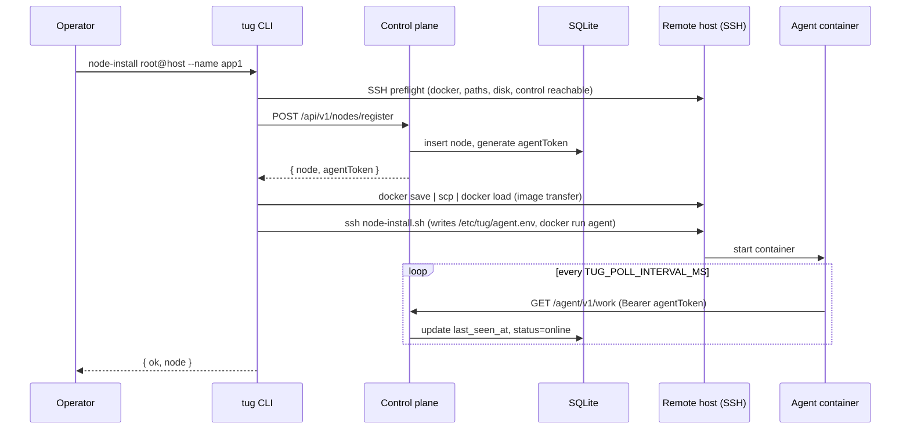
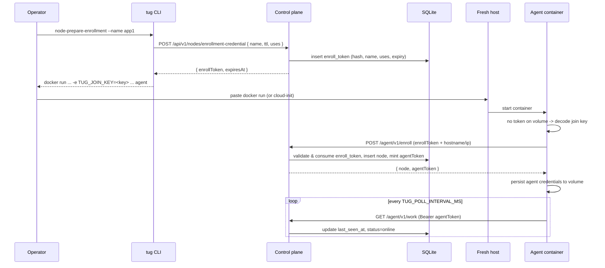
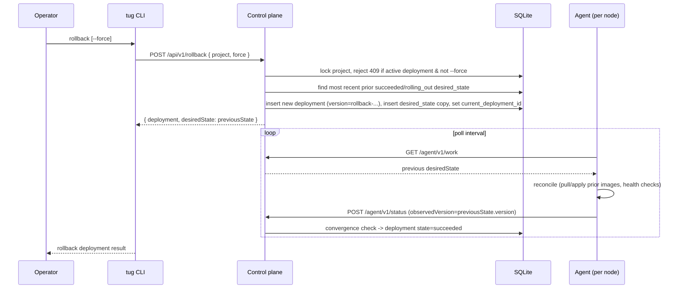
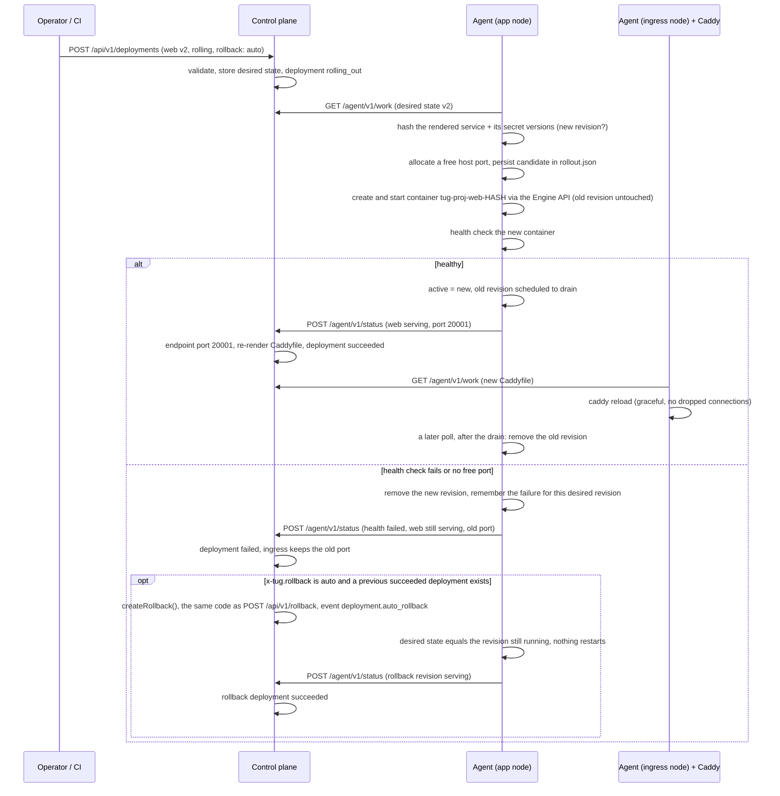

# Architecture

Tug deploys Docker Compose projects to one or more Docker hosts through a small self-hosted control plane and a pull-based agent on each node. SSH is used only to bootstrap hosts; normal deploys go through the control API and the agents.

## Components

The [README](../README.md#how-it-fits-together) has an overview diagram of how these fit together.

- **Control plane** (`src/control.ts`): an Express API backed by SQLite (`tug.db`) and an install-time master key (`master.key`) in `TUG_DATA_DIR`. It stores nodes, projects, deployments, desired states, encrypted secrets, volumes, queued commands, events, hashed API tokens and locks, and builds images from uploaded source tarballs or imports operator-built archives. It always stores and serves built images as compressed artifacts and resolves published image tags to immutable registry digests before publication.
- **Access control** (`src/credentials.ts`): every operator route is declared once in a role table (`read`, `deploy`, `admin`) and passes through one guard that authenticates the bearer (the root operator token or a named API token, both by hash lookup), checks the role and the token's allowed projects, and attaches the acting token name that deployments and audit events record. Agents authenticate separately with per-node tokens. See [Access control](access-control.md).
- **Agent** (`src/agent.ts`): runs on every node, fetches authoritative work from `GET /agent/v1/work` and reconciles containers through the Docker Engine API (`src/docker-api.ts`) over the local socket. It builds one container definition per placed service (`src/container-spec.ts`), substitutes released secrets into the container environment, verifies/downloads/loads artifact-backed images, pulls published images by their pinned registry digest when the desired revision is new to the node, executes health checks, and reports status. Nodes need only the Docker Engine, not the Compose plugin.
- **Reconciler** (`src/reconciler.ts`): one loop for every service. Containers carry `tug.project`, `tug.service`, `tug.revision` and `tug.config-hash` labels; the hash covers the resolved definition, the image identity and the versions of the secrets the service uses, and a container whose hash differs is replaced. `recreate` stops the old container and starts the new one; `rolling` (`x-tug.rollout.strategy: rolling`) starts the new one on a free host port beside the old one, health-checks it, lets the ingress switch and removes the old one after a drain. Tug names its own network `tug_<project>`, volumes `tug_<project>_<volume>` and containers `tug-<project>-<service>-<hash8>`; service names are network aliases. Reconciliation never removes volumes; `volume.delete` is the only way one goes away.
- **Compose normalization** (`src/normalize.ts`): `tug deploy` runs `docker compose config` on the operator machine, which does interpolation, `extends`, profiles and `env_file`. Control secrets are interpolated as `@@tug:secret:NAME@@` sentinels that the agent replaces with released values. The CLI reads Compose's YAML rendering because its JSON rendering drops service-level `x-tug`. Control validates the result against an allowlist of keys ([Compose](compose.md#supported-keys)); agents never parse Compose YAML.
- **CLI** (`src/cli.ts`): the `tug` command for operators. It talks to the control API and uses SSH only for `control-install` and `node-install`. See [CLI reference](cli.md).
- **Networking** (`src/mesh.ts`, `src/ingress.ts`): optional WireGuard mesh, health-aware service endpoints and the managed Caddy edge. `mesh.ts` has overlay IP allocation, key handling, `wg` config rendering, peer diffing and the idempotent `wg0` reconcile; `ingress.ts` resolves service endpoints and ingress routes, renders the Caddyfile (control) and reconciles the Caddy container (agent). See [Networking](networking.md).
- **Entrypoint** (`src/main.ts`, `dist/main.js` in the image): one image serves both roles; `node src/main.ts control|agent` or `TUG_ROLE`.
- **Protocol** (`src/protocol.ts`): the control↔agent contract. It holds the types, and a few shared constants such as the active and terminal deployment states, for everything crossing the boundary: `DesiredState`, `ServiceSpec` and `HealthCheck`; the `/agent/v1/*` payloads (`WorkResponse` with its optional `network`, `serviceEndpoints` and `ingress` blocks, `Command` / `CommandResult`, `StatusReport` / `ProjectStatus` / `IngressStatus`, `StreamMessage`, `WakeResponse`, `SecretsResponse`, `WgKeyRequest`); and enrollment (`EnrollRequest` / `EnrollResponse`, `RegisterResponse`, `JoinKey`). `control.ts`, `agent.ts`, `compose.ts` and `cli.ts` all import from it, so change the wire format there first.
- **Injectable agent runners** (`src/runners.ts`): `reconcile`, `executeCommand`, `waitForHealth`, `containerIp` and `pollOnce` take an `AgentContext` (`{ docker, http, nodeName, stateDir, apply, controlUrl, token, host?, mesh?, caddyImage? }`). `docker` is a `DockerRunner` (`createDockerRunner()` wraps `run('docker', …)` from `build.ts`), `host` is a `HostRunner` for `wg` and `ip` (`createHostRunner()`), and `http` is a `fetch`-compatible client. The Caddy reload goes through `docker`. Production code uses `defaultContext()`; `src/agent.test.ts` passes a fake docker runner to unit-test rollout ordering, secret-triggered `--force-recreate` and the docker, tcp and http health-check branches without a Docker daemon. The privileged-Docker integration test remains the end-to-end check.

## Desired state and reconciliation

`tug deploy` sends the Compose file to control, which validates `x-tug` placement (see [Compose extensions](compose.md)), optionally builds images for services with `build:`, and stores an immutable desired-state record for the deployment. Each agent receives the desired states that place services on its node, applies them, and reports the observed display version, immutable desired-state revision and health per project. When every node assigned to the current deployment reports that revision as `serving` (or `skipped`), the deployment becomes `succeeded`; if one reports `failed`, the deployment becomes `failed` and its error includes that node's apply error and any rollout errors, which is what `tug deploy` prints.

Deploys, rollbacks, secret changes and data-deleting volume removals take a per-project operation lock, so concurrent operations on one project are rejected with `409`. Long builds renew the project lease and check ownership/cancellation before publication. Deploy publication, rollback and artifact backup/restore share an operation-lifetime writer queue. Rollback creates a new deployment and revision whose desired state copies the most recent earlier `succeeded` or `rolling_out` one. With `x-tug.rollback: auto` control creates that rollback itself when a deployment turns `failed`; see [Rolling rollouts and automatic rollback](#rolling-rollouts-and-automatic-rollback).

Restarts, log fetches, diagnostics and volume deletions are queued as commands for the node that runs the service; control wakes that node, and the agent fetches the command and posts its result back.

### Agent wake channel

After each reconciliation, the agent waits on `GET /agent/v1/stream`, an authenticated WebSocket upgrade using the same per-node bearer token as the HTTP agent API. Control sends a `work-available` hint for durable work; desired state and queued commands remain in SQLite and the agent always fetches them through `GET /agent/v1/work`. Deployments, rollbacks, secret changes and cluster-wide network changes wake every node because they can change placement, service endpoints or ingress. Node commands and ingress-role changes wake only their target node.

The same socket carries ephemeral live operations. The CLI opens authenticated `GET /api/v1/live`, sends one versioned request, and control resolves the project, service and optional node before binding the session to that exact connected agent. For a rolling service, the agent addresses the active rollout container instead of the Compose service container. `exec` (with a PTY when asked), `tug run` one-off containers, `logs -f`, `ps` and `inspect` stream responses directly; input, cancellation and disconnect cleanup travel in the other direction. Live requests are never persisted, queued or replayed, all three hops enforce frame, buffer and session limits, and losing any socket closes the session and kills the agent's local Docker client process. Docker does not expose the remote exec process identity through this client stream, so an already-started process inside the container may continue after cancellation or disconnect; do not treat client cancellation as remote process termination. `inspect` is deliberately a `deploy` operation because raw Docker data can expose environment variables.

If a proxy or firewall rejects WebSockets, the agent uses `GET /agent/v1/wake?after=<cursor>&timeout=<milliseconds>` for durable work only. Each node has a monotonic in-memory wake cursor, so a wake issued just before the long poll begins is returned immediately instead of being lost. Cursors and sockets are intentionally ephemeral: control restart merely loses a hint, while periodic `TUG_POLL_INTERVAL_MS` reconciliation remains the correctness and drift-repair path. Live operations require the WebSocket path because replaying them through long-poll would be unsafe.

### Events

Agents report lifecycle events to control, and `tug events` shows them next to control's own audit events. An agent does not report that it is still reconciling: for the recreated services of a project it keeps a fingerprint of the desired revision, the Compose file rendered for its node and the secret versions in its own database (`event_state` in `agent.db`), and sends `service.pulling`, `starting`, `health_checking` and `serving` only when the fingerprint changes. A failed apply produces one `service.failed` event (level `error`, naming the service whose check failed and why) and retries of the same failure stay quiet. When the apply later succeeds the agent sends one `service.serving` event saying it recovered. The agent still applies and health-checks the project after every wake or poll, so drift is repaired the same way; only the events are quiet. Rolling services report their own events when a revision is started, switched or rejected. Control deletes events older than `TUG_EVENT_RETENTION_DAYS` (30) and keeps at most `TUG_EVENT_MAX_ROWS` (100,000); see [Configuration](configuration.md#control-plane).

## SQLite storage

Control metadata and agent applied/event state use Node's built-in synchronous SQLite driver. `src/db-driver.ts` owns the runtime-neutral `Db` contract, binding values and unique/busy error categories; `src/db-node.ts` alone imports `node:sqlite`. Queries return ordinary objects, missing rows are `undefined`, `all<Row>()` returns `Row[]`, and writes expose numeric change counts. Only anonymous `?` parameters are supported, with strict arity and value validation. Integer reads use numbers and reject unsafe values. Unexpected driver failures propagate with their original identity; classified errors preserve the driver error as their cause.

`src/db.ts` selects one connection factory for control, agents and restore snapshots. Writable connections enable WAL, foreign keys and a 1,000 ms busy timeout; initialization closes the connection on failure. Read-only snapshots require an existing file and run no schema creation or journal-mode change. Schemas initialize in place without migrations. Deployment publication executes synchronously from `BEGIN IMMEDIATE` through commit or rollback; writer queues and project leases coordinate workflows that also await files, Docker or network operations.

SQL executes on the owning process's event loop. Busy waits, snapshots and integrity checks can pause APIs, WebSocket traffic and timers; backup blocking is described in [Control plane](control-plane.md#backup-and-restore). Database-only work does not return promises. Filesystem preparation and other asynchronous workflows retain their asynchronous interfaces.

A future Bun bundle that includes control or agent code can supply a `bun:sqlite` adapter through the same factory. Select it at build time so the bundle never imports the Node adapter; normalize results, bindings, error categories and connection cleanup, and run the same factory-driven database contract tests. Bun implementation and build aliases are deferred. The proposed CLI-only executable does not access SQLite and needs no adapter.

## Image artifacts

The `builds` table records immutable image references, config-digest identity, platform, archive SHA-256/size and a relative artifact path. Image save/download/hash operations stream bytes; saved archives are validated before import. Build archives finalize before the desired-state transaction becomes current. Failed publication leaves the previous deployment current. `GET /agent/v1/images/:buildId` authenticates the node token and checks the retained service placement; `WorkResponse.retainedImages` protects rollback images from agent pruning.

Docker image stores can expose either a config digest or an OCI index/manifest digest as their local image ID. Artifacts use the saved configuration digest as their canonical identity. After a verified import, agents cache the daemon's actual tag ID paired with that canonical ID and archive hash; they check the tag again before reusing it. This permits classic Docker and containerd-backed Docker to exchange saved images without confusing their different IDs.

Archives are validated before Docker can import them. A containerd-backed `docker save` can list BuildKit build attestations of the image next to it, either nested in the image index or as extra top-level entries. These are accepted only when they carry no image name, their in-toto contents match their digests, and their subject is this exact image; any other extra manifest, extra tag, link, absolute or parent-relative path, or oversized entry rejects the archive.

Local builds use a multipart `POST /api/v1/deployments`: `payload` contains the Compose/project/version and `localImages` descriptors; each descriptor names a corresponding `image-N` file. Each archive must contain exactly its declared Tug tag and actual configuration/platform/checksum. Source contexts and local images are mutually exclusive. Control retags imported images under its own deployment identity before publishing their saved archives.

## Node bootstrap (`tug node-install`)



## Self-service enrollment (`tug node-prepare-enrollment`)



## Deploy (`tug deploy`)

```mermaid
sequenceDiagram
    participant Op as Operator
    participant CLI as tug CLI
    participant Ctrl as Control plane
    participant DB as SQLite
    participant Agent as Agent (per node)

    Op->>CLI: deploy -f docker-compose.yml
    CLI->>CLI: read & hash compose, tar build context
    CLI->>Ctrl: POST /api/v1/deployments (compose + context)
    Ctrl->>DB: lock project, insert deployment (state=building)
    Ctrl->>Ctrl: build images; save archives; pin published image digests
    Ctrl->>DB: insert desired_state, set current_deployment_id, state=rolling_out
    Ctrl-->>CLI: { deployment, desiredState }
    loop poll interval
        Agent->>Ctrl: GET /agent/v1/work
        Ctrl-->>Agent: matching desiredStates for this node
        Agent->>Agent: fetch secrets, pull or load images, recreate containers whose config hash changed, health checks
        Agent->>Ctrl: POST /agent/v1/status (observedVersion, observedRevision, health)
        Ctrl->>DB: upsert node_statuses, check convergence
    end
    Ctrl->>DB: all nodes serving desired revision -> deployment state=succeeded
    CLI->>Ctrl: GET /api/v1/deployments/:id (poll until terminal state)
    CLI-->>Op: deployment result
```

## Rollback (`tug rollback`)



## Rolling rollouts and automatic rollback

Services are `recreate` by default: a container whose config hash changed is stopped and replaced in place. A service with `x-tug.rollout.strategy: rolling` is rolled instead, one changed service at a time:



Rules the agent follows (`src/reconciler.ts`):

- A revision is identified by a hash of the rendered service (image id for built images, environment, `extra_hosts`, ports shape, volumes) and the versions of the secrets it references. The same hash means the revision is already running and nothing is restarted; a secret change rolls the service instead of force-recreating it.
- Each revision is a container `tug-<project>-<service>-<hash8>` on the project network, with the single published port remapped to a free port from `TUG_ROLLOUT_PORTS` (default 20000-20999) and the bind address kept. A running container that predates the rollout state is adopted as the active revision.
- State lives in `<state dir>/projects/<project>/rollout.json`: the active revision, a candidate (written before `up`, so a restarted agent resumes the same project and port instead of starting a second one), revisions waiting to drain with their deadline, and the last rejected revision per service so it is not retried on every poll. Drain deadlines are checked on every poll, so a drain never blocks the poll loop.
- A failed health check, an exhausted port range or a failed start removes the candidate and leaves the active revision untouched. The node reports `health: failed` and the rejection reason, while the service state stays `serving` with the old port so control keeps routing to it. If a recreated service of the same project fails, rolling services keep being reported serving the same way.
- Control resolves each endpoint's `port` from the service state, so the ingress follows takeovers without any ingress-specific agent protocol. Convergence is unchanged: `failed` still comes from a node reporting failed health for the current revision.
- Automatic rollback runs on control right after the status update that moved a deployment from `rolling_out` to `failed`. `scheduleAutoRollback` works in the background so a busy writer queue never blocks status reports, skips rollback deployments (their versions start with the reserved `rollback-`), requires the failed deployment to still be current, and takes the writer queue and project lock like a manual rollback. On a rolling node the previous revision is still running, so applying the rollback restarts nothing; other nodes recreate as usual.

## Networking

With `TUG_MESH=true`, `GET /agent/v1/work` also returns a `network` block (this node's overlay IP and every other node's WireGuard peer), `serviceEndpoints` (serving endpoints per service for injecting `extra_hosts`) and, for nodes marked as ingress nodes, an `ingress` block with the rendered Caddyfile. Agents report their public key with `POST /agent/v1/wireguard/key` (or `wgPublicKey` at enrollment) and ingress state in the status report. Control stores overlay IPs in `nodes.overlay_ip` and keys in `wg_peers`. See [Networking](networking.md) for the model and the mesh/ingress sequence diagram.

## Secrets

Secrets are encrypted at rest with AES-256-GCM using the control master key, and versioned per project. An agent only receives the secrets referenced by the `environment` of services placed on its node, substituted into the container environment by the agent (no file on disk). When only a referenced secret's version changes, the agent force-recreates just the affected services.

## Runtime paths

Agents write generated state under `TUG_STATE_DIR` (default `/var/lib/tug`):

```text
/var/lib/tug/agent.json                                # durable creds persisted after self-service enrollment
/var/lib/tug/agent.db                                  # last applied version/revision and secret versions per project
/var/lib/tug/managed-images.json                       # only Tug-owned image references eligible for conservative pruning
/var/lib/tug/image-identities.json                     # canonical artifact identities paired with daemon-local tag IDs
/var/lib/tug/wireguard/private.key                     # mesh only: node's WireGuard private key (0600), never sent to control
/var/lib/tug/wireguard/wg0.conf                        # mesh only: last config passed to `wg syncconf`
/var/lib/tug/ingress/                                  # ingress nodes only: applied Caddy config and its hash
/var/lib/tug/projects/<project>/rollout.json               # rolling services: active/candidate/draining revisions and the last rejected one
```

When agents enroll via `node-prepare-enrollment`, mount the state directory as a named volume (`-v tug-agent:/var/lib/tug`) so `agent.json` survives container recreation and the agent does not re-enroll after an image update or reboot.
