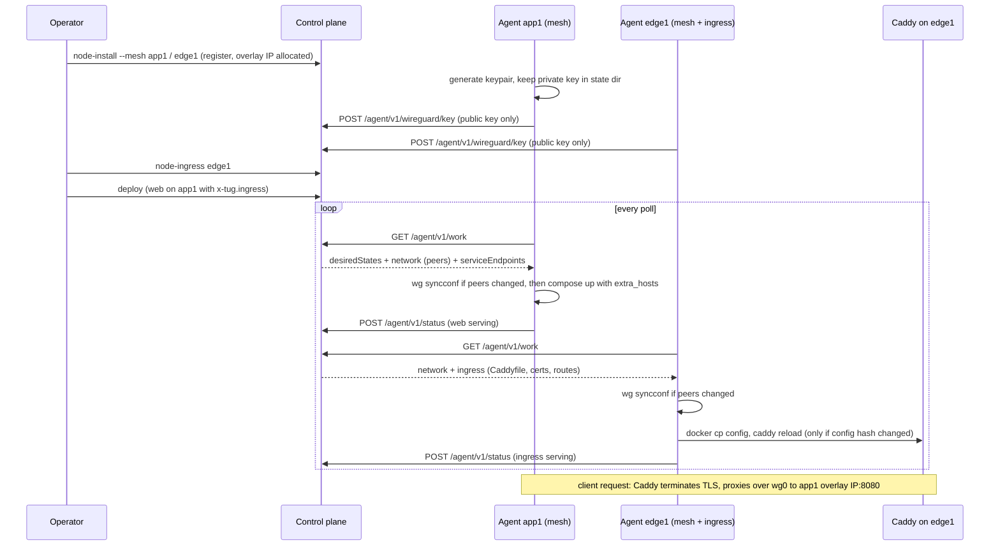

# Networking: mesh, service DNS and ingress

Three independent, opt-in layers let services on different hosts find each other and let the internet find them. With every layer off, deploys behave exactly as before. The control plane stays single-writer: it allocates addresses, stores peers and renders configuration, but never carries data-plane traffic.

| Layer | What it adds | Turned on by |
|---|---|---|
| A. WireGuard mesh | Every node gets an overlay IP and a `wg0` tunnel to every other node | `TUG_MESH=true` on control and on each agent |
| B. Service DNS | Services on other nodes resolve by name to their node's overlay IP, only while healthy | on by default with the mesh; `TUG_SERVICE_NAMES` on control overrides |
| C. Ingress and TLS | A managed Caddy on an ingress node routes hostnames to services anywhere, with automatic HTTPS | `tug node-ingress <node>` plus `x-tug.ingress` on a service |

Independently of the layers, [published ports are private by default](#published-ports-private-by-default): Tug binds them to the address other nodes and the ingress use, never to every interface unless you wrote that.

## Layer A: WireGuard mesh

Control owns addressing. When `TUG_MESH=true`, registering or enrolling a node allocates a stable `nodes.overlay_ip` from `TUG_MESH_CIDR` (default `10.210.0.0/16`, first free host address; re-registering keeps it). The default does not overlap the integration subnet `10.89.240.0/24`, Docker's default `172.16.0.0/12` pools or the usual home and VPN ranges; pick another CIDR if it collides with a network you route to. The mesh needs at least a `/29`.

Keys never leave the node. The agent generates an X25519 keypair locally, keeps the private key in `<state dir>/wireguard/private.key` (mode `0600`) and sends only the public key: at enrollment (`wgPublicKey`), or on its first poll with `POST /agent/v1/wireguard/key` for nodes registered by the CLI or `node-install`. Control stores it in the `wg_peers` table (`node_id`, `public_key`, `overlay_ip`, `endpoint`, `allowed_ips`).

Every `GET /agent/v1/work` response then carries a `network` block (see `NetworkConfig` in `src/protocol.ts`): this node's overlay IP, the mesh CIDR, the listen port and one peer per other node with a key. Each poll the agent compares that with `wg show wg0 dump` and:

1. creates `wg0` only when it is missing, assigns `<overlay ip>/<prefix>` (idempotent `ip address replace`) and brings it up with MTU 1420;
2. runs `wg syncconf` only when the interface key, listen port or peer set differs, so quiet polls change nothing and established tunnels are never torn down;
3. gives every peer `AllowedIPs = <peer overlay ip>/32` and `PersistentKeepalive = 25`.

A peer's `Endpoint` is the node's `public_address` (the WireGuard port is appended when the address has none). A node without a public address is behind NAT: it has no endpoint in other nodes' configs, but it dials out to everyone who does, and the keepalive keeps its mapping open so they can reply. At least one node in each connected pair must therefore have a reachable `public_address`. Peers whose configured endpoint changes are updated; endpoints WireGuard learned by roaming are left alone.

Containers reach other nodes through the host: traffic leaves the container, is routed by the host over `wg0` to the peer's overlay IP and is masqueraded by Docker, so the target sees the source node's overlay address. This is the host-routed model. Routable container networks (advertising per-project subnets in `AllowedIPs`) are deferred.

`control-install --mesh` sets `TUG_MESH=true` on control. Retire a node with `tug node-remove`, which drops its overlay peer so the others stop dialing it.

**Running the agent.** The agent needs `wg` and `ip` (both are in the Tug image), `NET_ADMIN`, and the host network namespace so that `wg0` exists on the host. `node-install --mesh` and `node-prepare-enrollment --mesh` generate the right `docker run` (`--network host --cap-add NET_ADMIN -e TUG_MESH=true`). The host needs WireGuard support in the kernel (built in since Linux 5.6; older kernels need the `wireguard` module or DKMS package).

**Key rotation.** `tug node-rotate-wg-key <node>` queues a `wg.rotate-key` command. The agent generates a new keypair, reports the public key and returns it in the command result; every other node picks up the new key on its next poll, and the node itself resyncs `wg0` with the new private key. Expect a few seconds of lost traffic to that node. A rotation that fails after the key was replaced is retried by the normal key report on the next poll.

**Firewall.** Open UDP `51820` (or `TUG_WG_PORT` on control) between nodes that act as endpoints. Allow outbound UDP from nodes behind NAT. Nothing else is required between nodes, and agents still only dial out to control over HTTP(S). `node-install --mesh` checks that kernel support exists and that the UDP port is free, or already held by this node's own running Tug mesh agent, so repeating the install to upgrade or repair an agent works.

## Layer B: service DNS

Decision: `extra_hosts` injection, not a DNS service. It adds no long-running process, needs nothing new on the nodes and degrades gracefully; the cost is that records only change when the agent re-renders the project, which already happens on every poll.

When service DNS is on (default with the mesh; force with `TUG_SERVICE_NAMES=true|false`), the work response carries `serviceEndpoints`: for each project on the node, each service to the list of `{ node, address }` where

- the service is placed on that node,
- the node has polled within `TUG_STALE_SECONDS`, and
- the node's latest status reports that service as `rolloutState: serving` (so a failing health check withdraws the record).

`address` is the node's overlay IP, or its `address` column when it has no mesh key. `composeForNode` adds `extra_hosts` to every service on the node for every service that runs elsewhere, as both `<service>` and `<service>.<project>.tug`. Services placed on the same node keep resolving through Compose's own DNS, and entries you wrote yourself in `extra_hosts` win. A service on several nodes gets one entry per serving node.

Consequences:

- The name resolves to the node's address, not the container. The target service must publish its port (`ports: ["3306:3306"]`) and clients connect to the published host port. Tug binds that port to the same address the name resolves to ([Published ports](#published-ports-private-by-default)), so it is not on the internet. Rolling services are the exception, see [Rolling services and service names](#rolling-services-and-service-names).
- `/etc/hosts` has no load balancing: most resolvers use the first entry, so multi-node services give failover on node loss rather than round robin. Real load balancing is a non-goal.
- Records appear after the target reports `serving` and the client's node re-renders its Compose file on its next poll, which recreates the client container if its `extra_hosts` changed. Order dependent services with health checks and expect one extra recreate on first deploy.

## Layer C: ingress and TLS

Decision: Caddy, as one managed container per ingress node, configured by a Caddyfile that control renders.

```yaml
services:
  web:
    image: nginx:1.27-alpine
    ports:
      - "8080:80"
    x-tug:
      placement:
        nodes: [app1]
      ingress:
        host: app.example.com
        port: 80
        tls: auto
```

An ingress hostname belongs to one project: a deploy or rollback is refused with `409` if another project's current deployment already routes the host (case-insensitive). `tug node-ingress edge1` marks a node as an ingress node (`--disable` removes the role). `port` may be the container port or the published host port; control resolves it to the published host port, and `validateCompose` rejects an ingress port that is not published, because the edge reaches services on `<node address>:<published port>`.

Caddy dials each upstream where its port is bound ([Published ports](#published-ports-private-by-default)): `127.0.0.1` for a service whose ingress port listens on loopback on the ingress node, otherwise the node's overlay address (or `address`, without the mesh), including for services on the ingress node itself.

Control aggregates the `ingress` blocks of every project's current deployment, and for each ingress node renders:

- one site block per host with `reverse_proxy` to every serving endpoint, using `127.0.0.1` for loopback-bound services on the ingress node and the overlay (or plain node) address for the rest;
- no route at all for a host without a serving upstream (reported in `ingress.warnings` rather than serving errors), and only the first project for a host claimed twice;
- with `TUG_ACME_EMAIL`, a global `email` for ACME registration.

TLS modes:

- `auto` (default): Caddy obtains and renews certificates with ACME. Ports 80 and 443 must be reachable from the internet and the host's DNS record must point at the ingress node. A name such as `app.<ingress-ip>.sslip.io` resolves to that address without a domain you own. Let's Encrypt limits certificates per registered domain, and `sslip.io` is shared, so a burst of new hostnames can be refused.
- `custom`: `cert` and `key` name two project secrets holding the PEM certificate chain and private key (`tug secret-set WEB_CERT --project blog --value "$(cat fullchain.pem)"`). Deploy fails if either secret is missing. Control decrypts them only for the ingress node, which receives them as files in the work response; they never reach the nodes running the service, and they never appear in the Caddyfile.
- `off`: plain HTTP on port 80, for development.

The agent on an ingress node creates the `tug-caddy` container with host networking and three named volumes (`/data` for ACME accounts and certificates, `/config`, `/etc/caddy`), so certificates survive container recreation and image updates. Config is uploaded with the Engine API archive endpoint (which works whether the agent runs on the host or in a container) and applied with `caddy reload`, which swaps config gracefully without dropping connections or restarting the container. If Caddy rejects the config the agent restores the last applied files, reports `failed` with Caddy's error in the node's ingress status, and retries on the next poll; `tug doctor` flags ingress nodes that are not `serving`. Removing the ingress role removes the container but keeps the volumes. The Caddy image is `caddy:2-alpine` (override with `TUG_CADDY_IMAGE` on the agent).

For services with `x-tug.rollout.strategy: rolling`, the upstream port is the one the serving revision reports instead of the declared published port (see below).

Ingress works without the mesh: upstreams then use each node's `address`, which must be reachable from the ingress node.

## Published ports: private by default

A `ports` entry such as `"3306:3306"` would listen on every interface of the node, and Docker's iptables rules bypass host firewalls such as ufw, so the port would be on the internet unless a provider firewall blocks it. Tug therefore rewrites every `ports` entry that names no host IP in the per-node Compose file:

| Situation | Bound to |
|---|---|
| Mesh on and the node has reported its WireGuard key | the node's overlay IP |
| The service's ingress port, when only the managed Caddy on this node dials it | `127.0.0.1` |
| Otherwise | the node's `address` (a warning event when it is public) |
| The node has no `address` and no mesh key | `127.0.0.1` |

The address is always the one other nodes resolve the service to and the ingress dials, so cross-node service names and upstreams keep working.

"Only the managed Caddy on this node" means: this node is the only ingress node, the service runs on it, and every service of the project runs only on nodes where this service also runs, so no other node reaches it through a service name. That is the [small reference topology](roadmap.md#reference-topology) (app, database and Caddy on one node). Only the entry that publishes `x-tug.ingress.port` moves to loopback; other ports of the service follow the rest of the table.

Details:

- Short syntax gets the address prefixed (`10.210.0.2:3306:3306`, `10.210.0.2:5353:53/udp`, `10.210.0.2:8000-8010:8000-8010`); a container-only entry such as `"80"` becomes `10.210.0.2::80`, and an IPv6 address is bracketed. Long syntax gets `host_ip`.
- An entry that already names a host IP is left exactly as written, including `0.0.0.0` and `[::]`. That is how you publish something on purpose: `"0.0.0.0:2222:22"`.
- Control sends the binding in the work response (`ports`, `PortBinding` in `src/protocol.ts`): the address and, per project, the loopback services. A hostname `address` is resolved on the node, only when some port of the project binds to it; if it does not resolve the project fails to apply rather than falling back to every interface. The address must belong to one of the node's interfaces, otherwise Docker cannot bind it (`cannot assign requested address`). On a cloud VM whose public IP is 1:1 NAT (not on an interface), register the private address, or use the mesh.
- Without the mesh and with a public `address`, ports are bound to that public address and the agent sends one `ports.public` warning event naming the services (again whenever the set changes). Turn on the mesh, register a private `address`, or write the host IP in `ports` to make the exposure explicit.
- Rolling revisions keep the host IP when their host port is remapped, so revision ports (`TUG_ROLLOUT_PORTS`) are bound the same way.
- With the mesh, ports bind to the address on `wg0`. After a host reboot Docker may try to start containers before the agent has brought `wg0` up; those fail to bind and the agent's next `docker compose up -d` starts them.
- `tug doctor --nodes` runs a `ports.public` check on every agent: it lists containers of Tug projects (and their rolling revisions) listening on `0.0.0.0`, `::` or a public IP. It is a warning, not a failure, because an explicit `0.0.0.0` may be intended.

M12 (container networking over the mesh) will remove most published ports for internal traffic.

## Rolling services and service names

A service with `x-tug.rollout.strategy: rolling` ([Compose extensions](compose.md#rolling-rollouts)) is addressed through the ingress, and the design deliberately keeps service names stable while its port is not.

Decision: each revision of a rolling service publishes the ingress port on its own host port from `TUG_ROLLOUT_PORTS` (default `20000-20999`) so old and new revisions can run at the same time. The agent reports the serving revision's port in its status (`serviceStates.<service>.port`), control puts it into the endpoint (`ServiceEndpoint.port`) and the Caddyfile upstream becomes `<node address>:<revision port>`. A new revision is therefore invisible to the ingress until it is healthy, and a failed one is never routed to because the node keeps reporting the old revision (still `serving`) with the old port.

What this means for names:

- `extra_hosts` entries are `name -> node address` with no port, so a rollout does not change them. Dependents on other nodes are never recreated by a rollout, and a rollout never restarts services that did not change. This is why per-revision ports are safe for `extra_hosts` injection even though a hosts file cannot carry ports.
- The name of a rolling service on another node still resolves (to the node address, as long as that node reports the service serving), but clients dialing `web:8080` find nothing on the declared port, because rolling revisions do not hold it. Cross-node clients of a rolling service should use its ingress hostname. Giving rolling services a stable name and port would need a per-node proxy that owns the declared port, which is not implemented.
- On the same node, services in the main project reach a rolling service by name over the shared project network: every revision joins `<project>_default` with the service name as an alias, so the name resolves to whichever revisions are running. During the overlap (start, health check and drain) that can be both revisions, and a not-yet-healthy new revision can receive same-node name traffic. Put anything that must not see an unhealthy revision behind the ingress.
- Reaching a rolling service by its declared host port (for example `curl localhost:8080` on the node) does not work; the port moves with every rollout.
- The injected `extra_hosts` are part of a revision's identity, so a rolling service rolls again when another node's service starts or stops serving. On a real first deploy `web` rolled once without the `client` entry and again as soon as `client` on the edge node became serving. The extra rollout is graceful, because the ingress only switches to a healthy revision, but it does start a new container.

Ingress takeover timing: the new port reaches Caddy after the app node reports it (next poll), control renders a new Caddyfile and the ingress node polls and runs `caddy reload` (graceful, in-flight requests finish). The old revision is removed only after `drain`, which defaults to 30s, so there is no gap. Keep `drain` above the two poll intervals.

## Sequence



## Verifying

`npm run test:integration:network` starts three privileged fake VPSes with the mesh on (`vps-c` as ingress node), deploys `docker-compose.network-sample.yml`, and checks pings and a WireGuard handshake between nodes, name resolution of `web` from a container on another node, Caddy on `vps-c` serving `app.test` from `vps-a`, and connectivity after `node-rotate-wg-key`. It needs a Docker host whose kernel has WireGuard. See [Development](development.md#integration-test).
