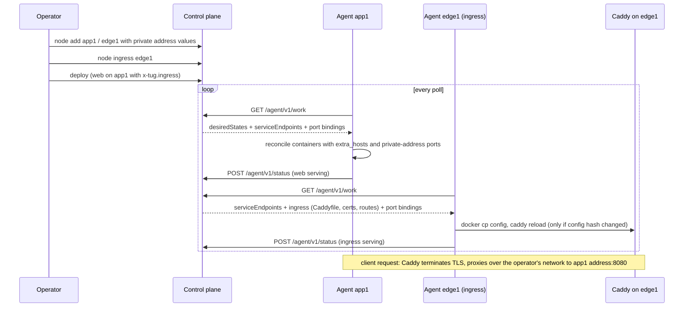

# Networking: node addresses, service names and ports

How services on different servers find each other, and which ports are public. Everything here uses the private network you already run. tug does not create an overlay network, and the control plane never carries workload traffic.

```sh
tug node address app2 10.0.0.7
tug doctor --nodes
```

The first command sets the private address other nodes use to reach `app2`. The second runs a `ports.public` check that warns about containers listening on all interfaces. To serve a hostname over HTTPS, see [Ingress and HTTPS](ingress.md).

| Topic | What it covers |
| --- | --- |
| [Bring your own network](#bring-your-own-network) | The node `address`, firewalls and what tug does not encrypt |
| [Cross-node service names](#cross-node-service-names) | Services on other nodes resolve by name to their node's `address` (hosts-file entries, not DNS), only while healthy. On by default, and `TUG_SERVICE_NAMES=false` on control turns it off |
| [Published ports](#published-ports-private-by-default) | Ports bind to the node's private address or loopback unless you write a host IP |
| [Rolling services and names](#rolling-services-and-service-names) | How names behave when a service rolls |

## Bring your own network

A node's `address` is its only inter-node address. Set it to a private IP on one of the host's interfaces with `node add --address`, the node's `address` config key, or `TUG_NODE_ADDRESS` at enrollment. Every node that runs a client or an ingress upstream must be able to route to that IP.

| Rule | Detail |
| --- | --- |
| Hostname | Accepted, but it must resolve on the node to an address Docker can bind |
| Change it | `tug node address <name> <address>` |
| Cloud NAT | Do not use a VM's public 1:1 NAT address when it is absent from its interfaces. Register the private interface address |
| Network | A VPC, LAN, VPN or other routed private network. tug allocates no addresses, creates no tunnels, configures no routes and provides no NAT traversal for workload traffic |
| Behind NAT | Agents can still dial out to control. Cross-node names and remote ingress upstreams work only where the workload network is reachable |
| Single node | Needs no inter-node network. When only the managed Caddy on the same node reaches an ingress port, tug binds that port to loopback |

**tug does not encrypt node-to-node workload traffic.** Mutual TLS protects connections to control, not connections between containers, published ports or ingress upstreams. Use application-layer TLS or an encrypted network you operate where traffic needs confidentiality or integrity.

Firewall the workload network so only the required peers reach published service ports. Allow ingress nodes to reach their upstream ports and application nodes to reach only the services they consume. Publish ports 80 and 443 on ingress nodes only. Keep databases and other internal services off public interfaces, and use a provider firewall as a second boundary, because Docker's iptables rules can bypass host firewalls such as ufw. An explicit `0.0.0.0` or `[::]` host IP in Compose requests all-interface exposure.

## Cross-node service names

Names are `extra_hosts` entries written into containers at creation, not a DNS service. There is no DNS server, no round-robin answer and no update between reconciliations, and nothing new runs on the nodes. Records change only when the agent re-renders the project, which happens on every poll. Names for services on the same node are Docker's own network DNS and are unrelated.

While enabled, the work response carries `serviceEndpoints`: for each project on the node, each service maps to a list of `{ node, address }` where:

- the service is placed on that node,
- the node has polled within `TUG_STALE_SECONDS`, and
- the node's latest status reports the service as `rolloutState: serving`, so a failing health check withdraws the record.

`address` is the node's configured `address`. The agent resolves a hostname address on the client node before writing it into `extra_hosts`, and omits endpoints that cannot resolve. It adds both `<service>` and `<service>.<project>.tug` to every service on the node for every service that runs elsewhere. Same-node services keep resolving through Docker DNS, entries you wrote yourself in `extra_hosts` win, and a service on several nodes gets one entry per serving node.

What this means for you:

- **The name points at the node, not the container.** The target must publish its port (`ports: ["3306:3306"]`) and clients use the published host port. tug binds that port to the address the name resolves to, see [Published ports](#published-ports-private-by-default), and your network and firewall decide who can reach it. Rolling services differ, see [Rolling services and service names](#rolling-services-and-service-names).
- **Names do not balance traffic.** Address selection and connection retries depend on the client. Control withdraws failed or stale endpoints, and the client's agent applies the changed hosts entries by recreating its container; this permits reconnecting to a remaining endpoint but does not guarantee immediate or uninterrupted failover. Managed [HTTP ingress](ingress.md#what-control-renders) separately balances requests across serving replicas with round robin.
- **Records appear after the target reports `serving`** and the client's node re-renders on its next poll, which recreates the client container when its `extra_hosts` changed. Order dependent services with health checks and expect one extra recreate on the first deploy.

## Published ports: private by default

A `ports` entry such as `"3306:3306"` would listen on every interface of the node, and Docker's iptables rules bypass host firewalls such as ufw, so the port would be on the internet unless a provider firewall blocks it. tug therefore rewrites every `ports` entry that names no host IP in the container definition the agent builds:

| Situation | Bound to |
| --- | --- |
| The service's ingress port, when only the managed Caddy on this node dials it | `127.0.0.1` |
| Otherwise | The node's `address` (a warning event when it is public) |
| The node has no `address` | `127.0.0.1` |

A configured node `address` is the same one other nodes resolve the service to and the ingress dials, so cross-node names and upstreams keep working when the private network is reachable.

"Only the managed Caddy on this node" means this node is the only ingress node, the service runs on it, and every service of the project runs only on nodes where this service also runs, so no other node reaches it through a service name. That is the [small reference topology](roadmap.md#reference-topology): app, database and Caddy on one node. Only the entry that publishes `x-tug.ingress.port` moves to loopback, and other ports of the service follow the rest of the table.

| Detail | Behavior |
| --- | --- |
| Short syntax | The address is prefixed: `10.0.0.8:3306:3306`, `10.0.0.8:5353:53/udp`, `10.0.0.8:8000-8010:8000-8010`. A container-only entry such as `"80"` becomes `10.0.0.8::80`, and an IPv6 address is bracketed |
| Long syntax | Gets `host_ip` |
| Explicit host IP | Left exactly as written, including `0.0.0.0` and `[::]`. This is how you publish on purpose: `"0.0.0.0:2222:22"` |
| Protocol | Control sends the binding in the work response (`ports`, `PortBinding` in `src/protocol.ts`): the address and, per project, the loopback services |
| Hostname `address` | Resolved on the node, only when some port of the project binds to it. If it does not resolve, the project fails to apply rather than falling back to every interface. The address must belong to one of the node's interfaces, or Docker cannot bind it (`cannot assign requested address`) |
| Public `address` | Ports bind to that public address and the agent sends one `ports.public` warning event naming the services, again whenever the set changes. Register a private `address`, or write the host IP in `ports` to make the exposure explicit |
| Rolling revisions | Keep the host IP when their host port is remapped, so revision ports (`TUG_ROLLOUT_PORTS`) are bound the same way |
| `tug doctor --nodes` | Runs a `ports.public` check on every agent. It lists containers of tug projects (and rolling revisions) on `0.0.0.0`, `::` or a public IP. It is a warning, not a failure, because an explicit `0.0.0.0` may be intended |

## Rolling services and service names

A service with `x-tug.rollout.strategy: rolling` ([Compose extensions](compose.md#rolling-rollouts)) is addressed through the ingress. Its service name stays stable while its port does not.

Each revision publishes the ingress port on its own host port from `TUG_ROLLOUT_PORTS` (default `20000-20999`), so old and new revisions run at the same time. The agent reports the serving revision's port in its status (`serviceStates.<service>.port`), control puts it into the endpoint (`ServiceEndpoint.port`), and the Caddyfile upstream becomes `<node address>:<revision port>`. A new revision is invisible to the ingress until it is healthy, and a failed one is never routed to, because the node keeps reporting the old, still `serving` revision with the old port.

| Question | Answer |
| --- | --- |
| Do names change on rollout? | No. `extra_hosts` entries are `name -> node address` with no port, so a rollout does not change them. Dependents on other nodes are never recreated by a rollout, and a rollout never restarts services that did not change |
| Can another node call `web:8080`? | The name resolves to the node address while that node reports the service serving, but nothing listens on the declared port. Cross-node clients of a rolling service should use its ingress hostname. A stable name and port would need another mechanism that owns the declared port, and it is not implemented |
| Same-node clients? | Every revision joins `<project>_default` with the service name as an alias, so the name resolves to whichever revisions run. During the overlap (start, health check, drain) that can be both revisions, and a not-yet-healthy new revision can receive same-node traffic. Put anything that must not see an unhealthy revision behind the ingress |
| `curl localhost:8080` on the node? | Does not work. The port moves with every rollout |
| Do other nodes' changes roll it again? | Yes. The injected `extra_hosts` are part of a revision's identity, so a rolling service rolls again when another node's service starts or stops serving. On a real first deploy `web` rolled once without the `client` entry and again as soon as `client` on the edge node became serving. The extra rollout is graceful, because the ingress switches only to a healthy revision, but it starts a new container |

**Takeover timing.** The new port reaches Caddy after the app node reports it (next poll). Control renders a new Caddyfile, and the ingress node polls and runs `caddy reload`, so in-flight requests finish. The old revision is removed only after `drain` (default 30s), so there is no gap. Keep `drain` above the two poll intervals.

## How a request is set up



## Verifying

`npm run test:integration:network` starts three privileged fake VPSes with plain numeric node `address` values (`vps-c` as ingress node), deploys `tests/integration/compose/docker-compose.network-sample.yml`, and checks a container on `vps-b` fetching `http://web:8080` by its cross-node service name, Caddy on `vps-c` serving `app.test` from `vps-a`, and published ports bound to the intended private node addresses. See [Development](development.md#integration-test).

Cross-node host entry ordering is preserved across this release, including the first address a resolver may select. Endpoint appearance, removal or address change updates the hosts file by replacing the affected container. Excluding those changes from identity would preserve stale name resolution; tug does not provide an independent DNS service or a stable service VIP.
