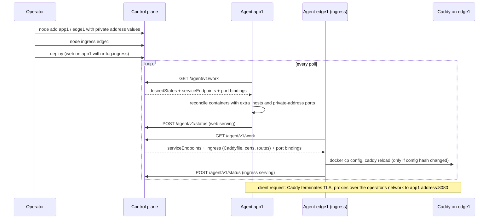

# Networking: cross-node service names and ingress

Two layers let services on different hosts find each other and let the internet find them. Both use the private network you already operate; Tug does not create an overlay network. The control plane stays single-writer: it resolves endpoints and renders configuration, but never carries workload traffic.

| Layer | What it adds | Turned on by |
|---|---|---|
| A. Cross-node service names | Services on other nodes resolve by name to their node's `address` (hosts-file entries, not DNS), only while healthy | On by default; set `TUG_SERVICE_NAMES=false` on control to opt out |
| B. Ingress and TLS | A managed Caddy on an ingress node routes hostnames to services anywhere, with automatic HTTPS | `tug node ingress <node>` plus `x-tug.ingress` on a service |

Independently of the layers, [published ports are private by default](#published-ports-private-by-default): Tug binds them to the address other nodes and the ingress use, never to every interface unless you wrote that.

## Bring your own network

A node's `address` is its sole inter-node address. Set it with `node add --address`, the node's `address` config key or `TUG_NODE_ADDRESS` at enrollment to a private IP on one of the host's interfaces. Every node that runs a client or an ingress upstream must be able to route to that IP. A hostname is also accepted, but it must resolve on the node to an address Docker can bind. Update a registered address with `tug node address <name> <address>`. Do not use a cloud VM's public 1:1 NAT address when that address is absent from its interfaces; register its private interface address instead.

The network can be a VPC, LAN, existing VPN or another routed private network. Tug does not allocate inter-node addresses, create tunnels, configure routes or provide NAT traversal for workload traffic. Agents can still dial out to control through NAT, but cross-node service names and remote ingress upstreams work only where this workload network is reachable.

**Tug does not encrypt node-to-node workload traffic.** Mutual TLS protects connections to control, not connections between application containers, published ports and ingress upstreams. Use application-layer TLS or an operator-managed encrypted network where the traffic needs confidentiality or integrity.

Firewall the workload network so only the required peers can reach the published service ports. Allow the ingress nodes to reach their upstream ports, and allow application nodes to reach only the services they consume; there is no need to open every port between every node. Publish ports 80 and 443 on ingress nodes only as required by the configured HTTP and ACME flows. Keep databases and other internal services off public interfaces and use a provider firewall as a second boundary: Docker's iptables rules can bypass host firewalls such as ufw. An explicit `0.0.0.0` or `[::]` host IP in Compose is a request for all-interface exposure.

A single-node project needs no inter-node network. When only the managed Caddy on the same node reaches an ingress port, Tug binds that port to loopback.

## Layer A: cross-node service names

Decision: `extra_hosts` injection, not a DNS service. The names are hosts-file entries written into containers at creation, so there is no DNS server, no round-robin answer and no update between reconciliations; "service DNS" is reserved for a possible future implementation. Names for services on the same node are Docker's own network DNS and are unrelated. Cross-node names add no long-running process and need nothing new on the nodes; the cost is that records only change when the agent re-renders the project, which already happens on every poll.

Cross-node service names are enabled by default. Set `TUG_SERVICE_NAMES=false` on control to disable them. While enabled, the work response carries `serviceEndpoints`: for each project on the node, each service to the list of `{ node, address }` where

- the service is placed on that node,
- the node has polled within `TUG_STALE_SECONDS`, and
- the node's latest status reports that service as `rolloutState: serving` (so a failing health check withdraws the record).

`address` is the node's configured `address`. The agent resolves a hostname address on the client node before writing it into `extra_hosts`; endpoints that cannot resolve are omitted until resolution succeeds, so the resulting entry is a `name:ip` value; a hostname must therefore resolve on the node. The agent's container definition (`containerSpecs`) adds `extra_hosts` to every service on the node for every service that runs elsewhere, as both `<service>` and `<service>.<project>.tug`. Services placed on the same node keep resolving through the project network's Docker DNS, and entries you wrote yourself in `extra_hosts` win. A service on several nodes gets one entry per serving node.

Consequences:

- The name resolves to the node's address, not the container. The target service must publish its port (`ports: ["3306:3306"]`) and clients connect to the published host port. Tug binds that port to the same address the name resolves to ([Published ports](#published-ports-private-by-default)); the operator's network and firewall determine who can reach it. Rolling services are the exception, see [Rolling services and service names](#rolling-services-and-service-names).
- `/etc/hosts` has no load balancing: most resolvers use the first entry, so multi-node services give failover on node loss rather than round robin. Real load balancing is a non-goal.
- Records appear after the target reports `serving` and the client's node re-renders its container definitions on its next poll, which recreates the client container if its `extra_hosts` changed. Order dependent services with health checks and expect one extra recreate on first deploy.

## Layer B: ingress and TLS

Decision: Caddy, as one managed container per ingress node, configured by a Caddyfile that control renders.

```yaml
# yaml-language-server: $schema=https://unpkg.com/@wpelevator/tug/x-tug.schema.json
services:
  web:
    image: nginx:1.27-alpine
    ports:
      - "8080:80"
    x-tug:
      placement:
        nodes: [app1]
      ingress:
        host: app.example.com
        port: 80
        tls: auto
```

An ingress hostname belongs to one project: a deploy or rollback is refused with `409` if another project's current deployment already routes the host (case-insensitive). `tug node ingress edge1` marks a node as an ingress node (`--disable` removes the role). `port` may be the container port or the published host port; control resolves it to the published host port, and `validateCompose` rejects an ingress port that is not published, because the edge reaches services on `<node address>:<published port>`.

Caddy dials each upstream where its port is bound ([Published ports](#published-ports-private-by-default)): `127.0.0.1` for a service whose ingress port listens on loopback on the ingress node, otherwise the node's `address`, including for services on the ingress node itself. Remote addresses must be reachable from the ingress node over the operator's network.

Control aggregates the `ingress` blocks of every project's current deployment, and for each ingress node renders:

- one site block per host (all names of an `x-tug.ingress.host` list, and every mapped domain, share their route's block when their TLS mode allows it) with `reverse_proxy` to every serving endpoint, using `127.0.0.1` for loopback-bound services on the ingress node and the node `address` for the rest;
- for a host without a serving upstream, or with `x-tug.ingress.maintenance: true`, a site block that answers `503` with `Retry-After` and a short fixed text instead of proxying (listed in the work response's `ingress.warnings`, which no command shows yet), and only the first project for a host claimed twice;
- with `TUG_INGRESS_ACCESS_LOG=true`, a JSON access log per site on the container's output (off by default, because URLs and client IPs are personal data), and, whenever there is a route, Caddy's Prometheus metrics labelled per host on its admin endpoint (`127.0.0.1:2019/metrics` on the ingress node, never a public port; see the admin API limit below);
- with `TUG_ACME_EMAIL`, a global `email` for ACME registration.

TLS modes:

- `auto` (default): Caddy obtains and renews certificates with ACME. Ports 80 and 443 must be reachable from the internet and the host's DNS record must point at the ingress node. A name such as `app.<ingress-ip>.sslip.io` resolves to that address without a domain you own. Let's Encrypt limits certificates per registered domain, and `sslip.io` is shared, so a burst of new hostnames can be refused.
- `custom`: `cert` and `key` name two project secrets holding the PEM certificate chain and private key (`tug secret set WEB_CERT --project blog --value "$(cat fullchain.pem)"`). Deploy fails if either secret is missing. Control decrypts them only for the ingress node, which receives them as files in the work response; they never reach the nodes running the service, and they never appear in the Caddyfile.
- `off`: plain HTTP on port 80, for development.

The agent on an ingress node creates the `tug-caddy` container with host networking and three named volumes (`/data` for ACME accounts and certificates, `/config`, `/etc/caddy`), so certificates survive container recreation and image updates. Config is uploaded with the Engine API archive endpoint (which works whether the agent runs on the host or in a container) and applied with `caddy reload`, which swaps config gracefully without restarting the container or dropping in-flight HTTP requests (WebSockets are held open for a while after a reload, see [Edge features](#edge-features)). If Caddy rejects the config the agent restores the last applied files, reports `failed` with Caddy's error in the node's ingress status, and retries on the next poll; `tug doctor` flags ingress nodes that are not `serving`. Removing the ingress role removes the container but keeps the volumes. The Caddy image is `caddy:2-alpine` (override with `TUG_CADDY_IMAGE` on the agent).

For services with `x-tug.rollout.strategy: rolling`, the upstream port is the one the serving revision reports instead of the declared published port (see below). Control never routes to Caddy's loopback management ports (`2019` and `2021`), and an agent never allocates them to a revision, even when its `TUG_ROLLOUT_PORTS` range contains them.

Caddy's automatic HTTPS protects the client-to-ingress connection. It does not encrypt the subsequent HTTP connection from Caddy to a service on another node; that upstream connection uses the operator's network.

### Mapped domains and wildcard zones

A WordPress multisite can serve sites on different top-level domains (domain mapping) and on subdomains of a zone you control. Tug handles the two differently, and neither needs a wildcard certificate per customer domain, a custom Caddy build or an `ask` endpoint that calls WordPress.

- **Declared names:** `x-tug.ingress.host` takes a list, `host: [network.example.com, example.org, shop.other.net]`, for names that belong in the Compose file and its history. Every name shares the route and its TLS mode, so with `tls: custom` one certificate (a SAN or wildcard certificate) must cover them all. Changing the list is a deployment.
- **Mapped domains** (`example.org`, `shop.other.net`): for names added at runtime, add each one with `tug domain add <host> --service web` (or `POST /api/v1/domains`). Control stores it for the project and renders it as an extra address on that service's `x-tug.ingress` route, so it shares the route's upstreams, rollout switching and 503 behavior. No deployment is needed, and a redeploy or rollback keeps the list. The next agent poll reloads Caddy, which requests the certificate in the background; the domain's DNS must already point at the ingress node, and a browser may see a certificate error for a few seconds until it is issued. A service that has no `x-tug.ingress` route cannot take domains, and a domain whose service later loses its route is kept but not served (the work response's `ingress.warnings` says so). With `tls: custom` the certificate covers the declared names, so mapped domains (which can be any customer domain) still use automatic HTTPS, and with `tls: off` they are served over plain HTTP too.
- **Zones** (`*.network.example.com`): declare the wildcard as the route's `host`, or add it as a domain, with `tls: auto`. Each name under the zone is issued on demand as described under [Edge features](#edge-features); use `tls: custom` with a wildcard certificate instead when the network has many subdomains, because Let's Encrypt allows 50 certificates per registered domain per week.

Why Tug owns the list rather than asking WordPress: a hostname belongs to one project, and control rejects a domain, a declared host or a wildcard that overlaps another project's (on `domain add`, `deploy` and `rollback`), which an `ask` endpoint served by project code could not guarantee. Adding a domain is as privileged as publishing a host through `x-tug.ingress`, so it needs the `deploy` role for the project. Automation that adds domains when a site is mapped (a WordPress hook, a CI job) calls the same API with a `deploy` credential scoped to the project; like every Tug call it authenticates with that credential's client certificate. Domains appear as `domain.added` and `domain.removed` events with the acting credential. A mapped domain must be a plausible public name: an IP address, a label over 63 characters or a name over 253 is refused (a wildcard zone that is a public suffix such as `*.co.uk` is not detected and is the operator's responsibility). Domains live in the control database, not in the Compose file, so they are covered by control backups and moved with a restore; there is no export, so keep a record of them (the output of `tug domain list`) if you rebuild a project elsewhere.

### Edge features

The generated Caddyfile is deliberately small: per host one `reverse_proxy` with `lb_policy round_robin` and the resilience settings below, the TLS mode and the optional ACME email. It has no compression, response headers, timeouts or body limit. This subsection records what the proxy does to survive upstream churn, the remaining limits, how the surrounding tools compare and the direction; the remaining proposal is listed under [Later](roadmap.md#later--only-if-needed). It needs a current Caddy 2 image: the directives below were tested against 2.11.7, and a node that cached an older `caddy:2-alpine` is never re-pulled, so Caddy rejects the config, the ingress reports `failed` and deployments for routed projects wait for it. Pull a newer image on that node, or set `TUG_CADDY_IMAGE` to a pinned tag, and recreate the container.

Every route that has an upstream is generated with a `reverse_proxy` that has:

- `lb_try_duration 5s` and `lb_try_interval 250ms`: a request that finds no usable upstream keeps trying for five seconds instead of failing at once with a 502. This covers the gap between an upstream dying and the next agent poll withdrawing its endpoint, and a `recreate` restart. A refused connection is always retried; after a successful connect only `GET` is, so a `POST` is never replayed, but a `GET` that crashes the service is replayed for the whole window. There is deliberately no passive health check (`fail_duration`): after a shared blip it would mark every replica down together and stall requests for its whole duration, and the endpoint list is already health-aware.
- `stream_close_delay 5m`: Caddy closes WebSockets when its config is reloaded, and one Caddy serves every project on the node, so a deploy to one site would otherwise cut live WebSockets on all of them. Open WebSockets now keep running for up to five minutes after a reload that replaced their config, then close; clients are expected to reconnect, as they must for any deploy that removes the old revision. Each reload keeps the previous config generation alive while any of its streams is open, so frequent deploys with many open sockets hold memory and file descriptors in proportion.

Current limits worth knowing:

- **A WebSocket outlives a reload for five minutes at most.** After that Caddy closes it, so a long-lived connection on a site is still cut once every five minutes of reload churn at worst, and always when its upstream is removed. Plain HTTP requests in flight finish.
- **The 503 page is fixed text.** A host without a serving upstream, or in maintenance, answers a plain-text 503; a branded page would have to be a file the project controls, which is unsafe next to the other projects' keys in `/etc/caddy`.
- **Retries are bounded at five seconds.** A longer outage, such as a slow `recreate` restart, still returns a 502 once the window ends.
- **A host answering 503 still requests a certificate.** A `tls: auto` host with no serving upstream, or in maintenance, keeps its site block, so Caddy tries ACME for it and a first deploy that fails (or DNS that points elsewhere) produces failed validations, which Let's Encrypt rate limits per host and per registered domain and which then fall back to ZeroSSL. The benefit is a clear 503 and a certificate ready for the first success; the cost is that a typo in `host` or DNS that is not yet pointed at the node is no longer silent. Use `tls: off` while DNS is not ready.
- **The admin API is unauthenticated.** Caddy's admin endpoint on `127.0.0.1:2019`, which `caddy reload` and the metrics use, is reachable by any process on the node and by any container with host networking, and it accepts configuration, including one that serves `/etc/caddy`. This predates the metrics and is a reason to run only trusted workloads on an ingress node.
- **Access log size is capped only on new containers.** The `max-size 10m`, `max-file 3` log options apply when the agent creates `tug-caddy`; an ingress node that already has the container keeps Docker's unbounded default until it is recreated (`docker rm -f tug-caddy`; the next poll recreates it and keeps certificates). Do this before enabling `TUG_INGRESS_ACCESS_LOG`.
- **Wildcard hosts are issued name by name.** A wildcard host such as `*.network.example.com` with `tls: auto` cannot get one wildcard certificate (that needs the DNS-01 challenge, which stock `caddy:2-alpine` cannot do), so Caddy issues a certificate for each name under the zone the first time a client connects to it (on-demand TLS). Caddy asks a loopback-only endpoint it serves itself (`127.0.0.1:2021`, rendered by control from the wildcard hosts it routes) and approves exactly one label under the zone: `site1.network.example.com` yes, `a.b.network.example.com`, the bare zone and every other domain no, so only names under a zone a project declared can trigger issuance (control rejects overlaps between projects but cannot verify who controls the zone's DNS). The first visit to a new name waits for the certificate. Anyone who can make a name under the zone resolve to the node can trigger issuance, and with a wildcard DNS record that is anyone on the internet: a flood of random labels can use up Let's Encrypt's 50 certificates per registered domain per week and block real new sites. A public subdomain network should therefore use `tls: custom` with a wildcard certificate, which is not issued per name; keep on-demand zones for networks where the node is not publicly resolvable or a CDN or firewall limits who can connect.
- **`/etc/caddy` is shared by every project on the node,** including the keys of every `tls: custom` route. This is why ingress options are typed `x-tug.ingress` fields that control validates, not a raw Caddyfile fragment supplied by a project.

- **Certificate problems are invisible.** Caddy retries a failed issuance (DNS not yet pointed, a rate limit) with backoff and nothing in Tug reports it, and `tug domain list` does not say whether a domain is being served, only that it is mapped. Adding many domains at once starts that many ACME orders, which Let's Encrypt limits (new orders per account, failed validations per name). Point DNS first, add domains in moderate batches, and check `docker logs tug-caddy` on the ingress node.
- **Two loopback ports are reserved on ingress nodes.** The managed Caddy listens on `127.0.0.1:2019` (admin) and `127.0.0.1:2021` (the ask site, only when a wildcard zone is routed), so control rejects a deployment whose service may land on an ingress node and publishes either host port. A service that already did so before the node became an ingress node, or another process on the host, makes Caddy's reload fail for every site; free the port.

How the managed ingress compares, from each project's documentation (a blank means not confirmed, not no):

| Feature | Tug today | kamal-proxy | Uncloud (Caddy) | Traefik | Dokku (nginx) |
|---|---|---|---|---|---|
| Declared in | typed `x-tug.ingress` | CLI flags, `proxy:` in `deploy.yml` | `x-ports`, raw `x-caddy` | labels | per-app `nginx:set` |
| Health-gated cutover and drain | yes, for `rolling` services | yes | yes | no mechanism of its own | |
| Custom certificate from encrypted secrets | yes | yes | partial | partial | |
| Response timeout, max request body | no | yes | no | via middleware | yes |
| Access logs, metrics | yes (opt-in logs, metrics on loopback) | yes | logs | yes | logs |
| Compression, basic auth, redirects | no | no | via raw Caddy | yes | |
| Maintenance or error page | fixed 503 text, `maintenance: true` | no | partial | yes | yes |
| Rate limit, IP allowlist | no | no | no | yes | |
| HTTP/3 | yes (Caddy default, needs UDP 443 open) | | yes | yes | |
| On-demand TLS, DNS-01 wildcards | no | on-demand yes | partial | DNS-01 yes | |

Tug's strengths for an edge are that control renders and validates the whole Caddyfile (hostname and wildcard overlaps across projects are rejected before anything reaches Caddy), the endpoint list is already health-aware before Caddy sees it, secrets reach only the ingress node as files, and a reload is graceful, hash-gated and rolled back when Caddy rejects it. Caddy's retries are a second layer on top of that, not a replacement; its active health checks would duplicate `x-tug.health`.

The direction, in order:

1. Done: resilience defaults with no new key (retries, `stream_close_delay`), described above and exercised against a real Caddy by `tests/integration/ingress-resilience.test.ts`.
2. Done: opt-in JSON access logs, per-host Caddy metrics on the admin endpoint, and a 503 (or `maintenance: true`) response for a host with no serving upstream. Still proposed: reading those metrics into the status report and re-exporting them from control ([ingress metrics](observability.md#ingress-metrics)).
3. Optional per-route `x-tug.ingress` keys, each a minor release: response timeout, body limit, compression (stock Caddy `encode` offers gzip and zstd, not brotli), alias redirects, load-balancing policy, basic auth (the hash delivered as a secret file like a custom certificate) and an IP allowlist.
4. Per-node settings under `tug node ingress`: trusted proxies behind a CDN, ACME CA and fallback issuer. Wildcards stay `tls: custom` unless a real need justifies on-demand TLS or a DNS-01 Caddy build.

Out of scope for stock Caddy: rate limiting (needs a plugin) and path routing within one hostname (needs several services per host in the route model).

## Published ports: private by default

A `ports` entry such as `"3306:3306"` would listen on every interface of the node, and Docker's iptables rules bypass host firewalls such as ufw, so the port would be on the internet unless a provider firewall blocks it. Tug therefore rewrites every `ports` entry that names no host IP in the container definition the agent builds for the node:

| Situation | Bound to |
|---|---|
| The service's ingress port, when only the managed Caddy on this node dials it | `127.0.0.1` |
| Otherwise | the node's `address` (a warning event when it is public) |
| The node has no `address` | `127.0.0.1` |

When a node `address` is configured, it is the same one other nodes resolve the service to and the ingress dials, so cross-node service names and upstreams keep working when the private network is reachable.

"Only the managed Caddy on this node" means: this node is the only ingress node, the service runs on it, and every service of the project runs only on nodes where this service also runs, so no other node reaches it through a service name. That is the [small reference topology](roadmap.md#reference-topology) (app, database and Caddy on one node). Only the entry that publishes `x-tug.ingress.port` moves to loopback; other ports of the service follow the rest of the table.

Details:

- Short syntax gets the address prefixed (`10.0.0.8:3306:3306`, `10.0.0.8:5353:53/udp`, `10.0.0.8:8000-8010:8000-8010`); a container-only entry such as `"80"` becomes `10.0.0.8::80`, and an IPv6 address is bracketed. Long syntax gets `host_ip`.
- An entry that already names a host IP is left exactly as written, including `0.0.0.0` and `[::]`. That is how you publish something on purpose: `"0.0.0.0:2222:22"`.
- Control sends the binding in the work response (`ports`, `PortBinding` in `src/protocol.ts`): the address and, per project, the loopback services. A hostname `address` is resolved on the node, only when some port of the project binds to it; if it does not resolve the project fails to apply rather than falling back to every interface. The address must belong to one of the node's interfaces, otherwise Docker cannot bind it (`cannot assign requested address`).
- With a public `address`, ports are bound to that public address and the agent sends one `ports.public` warning event naming the services (again whenever the set changes). Register a private `address`, or write the host IP in `ports` to make the exposure explicit.
- Rolling revisions keep the host IP when their host port is remapped, so revision ports (`TUG_ROLLOUT_PORTS`) are bound the same way.
- `tug doctor --nodes` runs a `ports.public` check on every agent: it lists containers of Tug projects (and their rolling revisions) listening on `0.0.0.0`, `::` or a public IP. It is a warning, not a failure, because an explicit `0.0.0.0` may be intended.

## Rolling services and service names

A service with `x-tug.rollout.strategy: rolling` ([Compose extensions](compose.md#rolling-rollouts)) is addressed through the ingress, and the design deliberately keeps service names stable while its port is not.

Decision: each revision of a rolling service publishes the ingress port on its own host port from `TUG_ROLLOUT_PORTS` (default `20000-20999`) so old and new revisions can run at the same time. The agent reports the serving revision's port in its status (`serviceStates.<service>.port`), control puts it into the endpoint (`ServiceEndpoint.port`) and the Caddyfile upstream becomes `<node address>:<revision port>`. A new revision is therefore invisible to the ingress until it is healthy, and a failed one is never routed to because the node keeps reporting the old revision (still `serving`) with the old port.

What this means for names:

- `extra_hosts` entries are `name -> node address` with no port, so a rollout does not change them. Dependents on other nodes are never recreated by a rollout, and a rollout never restarts services that did not change. This is why per-revision ports are safe for `extra_hosts` injection even though a hosts file cannot carry ports.
- The name of a rolling service on another node still resolves (to the node address, as long as that node reports the service serving), but clients dialing `web:8080` find nothing on the declared port, because rolling revisions do not hold it. Cross-node clients of a rolling service should use its ingress hostname. Giving rolling services a stable name and port would need another mechanism that owns the declared port; it is not implemented.
- On the same node, services in the main project reach a rolling service by name over the shared project network: every revision joins `<project>_default` with the service name as an alias, so the name resolves to whichever revisions are running. During the overlap (start, health check and drain) that can be both revisions, and a not-yet-healthy new revision can receive same-node name traffic. Put anything that must not see an unhealthy revision behind the ingress.
- Reaching a rolling service by its declared host port (for example `curl localhost:8080` on the node) does not work; the port moves with every rollout.
- The injected `extra_hosts` are part of a revision's identity, so a rolling service rolls again when another node's service starts or stops serving. On a real first deploy `web` rolled once without the `client` entry and again as soon as `client` on the edge node became serving. The extra rollout is graceful, because the ingress only switches to a healthy revision, but it does start a new container.

Ingress takeover timing: the new port reaches Caddy after the app node reports it (next poll), control renders a new Caddyfile and the ingress node polls and runs `caddy reload` (graceful, in-flight requests finish). The old revision is removed only after `drain`, which defaults to 30s, so there is no gap. Keep `drain` above the two poll intervals.

## Sequence



## Verifying

`npm run test:integration:network` starts three privileged fake VPSes with plain numeric node `address` values (`vps-c` as ingress node), deploys `tests/integration/compose/docker-compose.network-sample.yml`, and checks a container on `vps-b` fetching `http://web:8080` by its cross-node service name, Caddy on `vps-c` serving `app.test` from `vps-a`, and published ports bound to the intended private node addresses rather than every interface. See [Development](development.md#integration-test).
