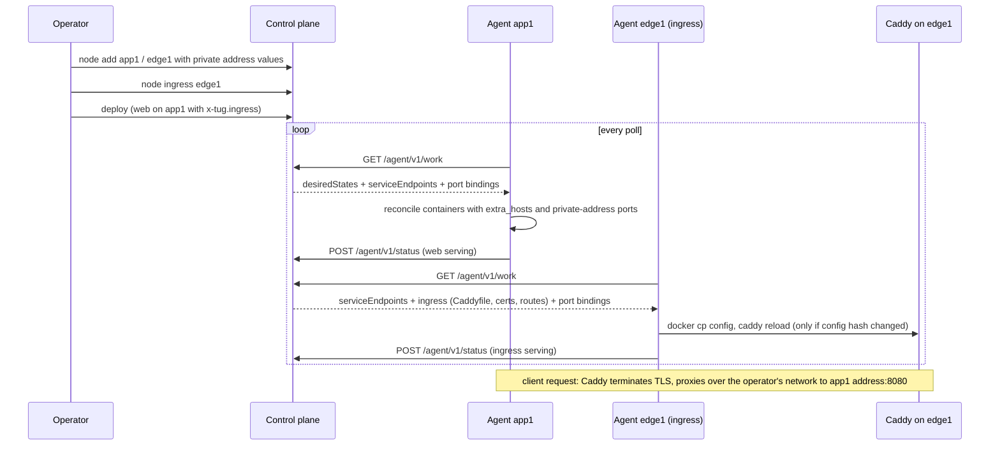

# Networking: hostnames, HTTPS and service names

Serve a hostname over HTTPS from one VPS, and let services on different servers find each other. Both use the private network you already run. Tug does not create an overlay network, and the control plane never carries workload traffic.

```sh
tug node ingress app1
tug deploy
```

With `x-tug.ingress` on a service (below), `tug node ingress app1` makes `app1` run a managed Caddy that routes the hostname to the service and gets a certificate for it. DNS must point at the server, and ports 80 and 443 must be reachable.

| Layer | What it adds | Turned on by |
| --- | --- | --- |
| A. [Cross-node service names](#layer-a-cross-node-service-names) | Services on other nodes resolve by name to their node's `address` (hosts-file entries, not DNS), only while healthy | On by default. `TUG_SERVICE_NAMES=false` on control turns it off |
| B. [Ingress and TLS](#layer-b-ingress-and-tls) | A managed Caddy on an ingress node routes hostnames to services anywhere, with automatic HTTPS | `tug node ingress <node>` plus `x-tug.ingress` on a service |

Independently of both layers, [published ports are private by default](#published-ports-private-by-default).

## Bring your own network

A node's `address` is its only inter-node address. Set it to a private IP on one of the host's interfaces with `node add --address`, the node's `address` config key, or `TUG_NODE_ADDRESS` at enrollment. Every node that runs a client or an ingress upstream must be able to route to that IP.

| Rule | Detail |
| --- | --- |
| Hostname | Accepted, but it must resolve on the node to an address Docker can bind |
| Change it | `tug node address <name> <address>` |
| Cloud NAT | Do not use a VM's public 1:1 NAT address when it is absent from its interfaces. Register the private interface address |
| Network | A VPC, LAN, VPN or other routed private network. Tug allocates no addresses, creates no tunnels, configures no routes and provides no NAT traversal for workload traffic |
| Behind NAT | Agents can still dial out to control. Cross-node names and remote ingress upstreams work only where the workload network is reachable |
| Single node | Needs no inter-node network. When only the managed Caddy on the same node reaches an ingress port, Tug binds that port to loopback |

**Tug does not encrypt node-to-node workload traffic.** Mutual TLS protects connections to control, not connections between containers, published ports or ingress upstreams. Use application-layer TLS or an encrypted network you operate where traffic needs confidentiality or integrity.

Firewall the workload network so only the required peers reach published service ports. Allow ingress nodes to reach their upstream ports and application nodes to reach only the services they consume. Publish ports 80 and 443 on ingress nodes only. Keep databases and other internal services off public interfaces, and use a provider firewall as a second boundary, because Docker's iptables rules can bypass host firewalls such as ufw. An explicit `0.0.0.0` or `[::]` host IP in Compose requests all-interface exposure.

## Layer A: cross-node service names

Names are `extra_hosts` entries written into containers at creation, not a DNS service. There is no DNS server, no round-robin answer and no update between reconciliations, and nothing new runs on the nodes. Records change only when the agent re-renders the project, which happens on every poll. Names for services on the same node are Docker's own network DNS and are unrelated.

While enabled, the work response carries `serviceEndpoints`: for each project on the node, each service maps to a list of `{ node, address }` where:

- the service is placed on that node,
- the node has polled within `TUG_STALE_SECONDS`, and
- the node's latest status reports the service as `rolloutState: serving`, so a failing health check withdraws the record.

`address` is the node's configured `address`. The agent resolves a hostname address on the client node before writing it into `extra_hosts`, and omits endpoints that cannot resolve. It adds both `<service>` and `<service>.<project>.tug` to every service on the node for every service that runs elsewhere. Same-node services keep resolving through Docker DNS, entries you wrote yourself in `extra_hosts` win, and a service on several nodes gets one entry per serving node.

What this means for you:

- **The name points at the node, not the container.** The target must publish its port (`ports: ["3306:3306"]`) and clients use the published host port. Tug binds that port to the address the name resolves to, see [Published ports](#published-ports-private-by-default), and your network and firewall decide who can reach it. Rolling services differ, see [Rolling services and service names](#rolling-services-and-service-names).
- **No load balancing.** Most resolvers use the first `/etc/hosts` entry, so a multi-node service gives failover on node loss, not round robin.
- **Records appear after the target reports `serving`** and the client's node re-renders on its next poll, which recreates the client container when its `extra_hosts` changed. Order dependent services with health checks and expect one extra recreate on the first deploy.

## Layer B: ingress and TLS

One managed Caddy container per ingress node, configured by a Caddyfile that control renders.

```yaml
# yaml-language-server: $schema=https://unpkg.com/@wpelevator/tug/x-tug.schema.json
services:
  web:
    image: nginx:1.27-alpine
    ports:
      - "8080:80"
    x-tug:
      placement:
        nodes: [app1]
      ingress:
        host: app.example.com
        port: 80
        tls: auto
```

`tug node ingress edge1` marks a node as an ingress node, and `--disable` removes the role. The `ingress` keys are in [Compose extensions](compose.md#ingress).

| Rule | Behavior |
| --- | --- |
| One project per host | A deploy or rollback is refused with `409` if another project's current deployment already routes the host (case-insensitive) |
| Port | May be the container port or the published host port. Control resolves it to the published host port, and deploy rejects an ingress port that is not published, because the edge reaches `<node address>:<published port>` |
| Upstream | Caddy dials where the port is bound: `127.0.0.1` for a service whose ingress port listens on loopback on the ingress node, otherwise the node's `address`, including for services on the ingress node. Remote addresses must be reachable from the ingress node |
| Backend encryption | Caddy's automatic HTTPS protects client to ingress. The connection from Caddy to a service on another node is plain HTTP over your network |
| Reserved ports | Control never routes to Caddy's loopback management ports `2019` and `2021`, and an agent never allocates them to a revision, even inside `TUG_ROLLOUT_PORTS` |

### TLS modes

| `tls` | Behavior |
| --- | --- |
| `auto` (default) | Caddy obtains and renews certificates with ACME. Ports 80 and 443 must be reachable from the internet and the host's DNS record must point at the ingress node. A name such as `app.<ingress-ip>.sslip.io` resolves to that address without a domain you own, but `sslip.io` is shared and Let's Encrypt limits certificates per registered domain, so a burst of new names can be refused |
| `custom` | `cert` and `key` name two project secrets holding the PEM chain and private key: `tug secret set WEB_CERT --project blog --value "$(cat fullchain.pem)"`. Deploy fails if either is missing. Control decrypts them only for the ingress node, which gets them as files in the work response. They never reach the nodes running the service and never appear in the Caddyfile |
| `off` | Plain HTTP on port 80, for development |

### What control renders

Control aggregates the `ingress` blocks of every project's current deployment. For each ingress node it renders:

- one site block per host (all names of a `host` list, and every mapped domain, share their route's block when their TLS mode allows) with `reverse_proxy` to every serving endpoint,
- for a host with no serving upstream, or with `maintenance: true`, a site block that answers `503` with `Retry-After` and a short fixed text instead of proxying (listed in the work response's `ingress.warnings`, which no command shows yet), and only the first project when a host is claimed twice,
- with `TUG_INGRESS_ACCESS_LOG=true`, a JSON access log per site on the container's output (off by default, because URLs and client IPs are personal data), and, whenever there is a route, Caddy's Prometheus metrics labelled per host on `127.0.0.1:2019/metrics` on the ingress node (never a public port),
- with `TUG_ACME_EMAIL`, a global `email` for ACME registration.

### The Caddy container

The agent on an ingress node creates `tug-caddy` with host networking and three named volumes (`/data` for ACME accounts and certificates, `/config`, `/etc/caddy`), so certificates survive recreation and image updates. It uploads config through the Engine API archive endpoint, which works whether the agent runs on the host or in a container, and applies it with `caddy reload`. A reload swaps config without restarting the container or dropping in-flight HTTP requests (WebSockets stay open for a while, see [Edge features](#edge-features)). If Caddy rejects the config, the agent restores the last applied files, reports `failed` with Caddy's error in the node's ingress status and retries on the next poll. `tug doctor` flags ingress nodes that are not `serving`. Removing the ingress role removes the container but keeps the volumes. The image is `caddy:2-alpine`, overridable with `TUG_CADDY_IMAGE` on the agent.

For `rolling` services the upstream port is the one the serving revision reports, not the declared published port.

## Mapped domains and wildcard zones

A WordPress multisite can serve sites on different top-level domains (domain mapping) and on subdomains of a zone you control. Neither needs a wildcard certificate per customer domain, a custom Caddy build or an `ask` endpoint that calls WordPress.

| Kind | Use for | How |
| --- | --- | --- |
| Declared names | Names that belong in the Compose file and its history | `x-tug.ingress.host` takes a list, `host: [network.example.com, example.org, shop.other.net]`. Every name shares the route and its TLS mode, so with `tls: custom` one certificate (SAN or wildcard) must cover them all. Changing the list is a deployment |
| Mapped domains | Names added at runtime (`example.org`, `shop.other.net`) | `tug domain add <host> --service web`, or `POST /api/v1/domains` |
| Zones | `*.network.example.com` | Declare the wildcard as the route's `host`, or add it as a domain, with `tls: auto`. Each name under the zone is issued on demand, see [Edge features](#edge-features). Use `tls: custom` with a wildcard certificate when the network has many subdomains, because Let's Encrypt allows 50 certificates per registered domain per week |

**How a mapped domain behaves.**

- **Route.** Control stores it for the project and renders it as an extra address on the service's ingress route, sharing its upstreams, rollout switching and 503 behavior. No deployment is needed, and a redeploy or rollback keeps the list.
- **Certificate.** The next agent poll reloads Caddy, which requests the certificate in the background. The domain's DNS must already point at the ingress node, and a browser may see a certificate error for a few seconds until it is issued.
- **TLS.** With `tls: custom`, the certificate covers the declared names, so mapped domains (which can be any customer domain) still use automatic HTTPS. With `tls: off` they are served over plain HTTP.
- **Requirements.** A service with no `x-tug.ingress` route cannot take domains. A domain whose service later loses its route is kept but not served, and `ingress.warnings` says so.
- **Validation.** A mapped domain must be a plausible public name. An IP address, a label over 63 characters or a name over 253 is refused. A wildcard zone that is a public suffix such as `*.co.uk` is not detected and is your responsibility.
- **Ownership.** A hostname belongs to one project. Control rejects a domain, declared host or wildcard that overlaps another project's, on `domain add`, `deploy` and `rollback`, which an `ask` endpoint served by project code could not guarantee.
- **Access.** Adding a domain is as privileged as publishing a host through `x-tug.ingress`, so it needs the `deploy` role for the project. Automation (a WordPress hook, a CI job) calls the same API with a `deploy` credential scoped to the project. Events `domain.added` and `domain.removed` record the acting credential.
- **Storage.** Domains live in the control database, not the Compose file, so control backups cover them and a restore brings them back. There is no export, so keep the output of `tug domain list` if you rebuild a project elsewhere.

## Edge features

The generated Caddyfile is small: per host one `reverse_proxy` with `lb_policy round_robin` and the resilience settings below, the TLS mode and the optional ACME email. It has no compression, response headers, timeouts or body limit. The proposals for more are in [Ingress edge features](ingress-features.md).

It needs a current Caddy 2 image. The directives were tested against 2.11.7. A node that cached an older `caddy:2-alpine` is never re-pulled, so Caddy rejects the config, ingress reports `failed` and deployments for routed projects wait for it. Pull a newer image on that node, or set `TUG_CADDY_IMAGE` to a pinned tag, and recreate the container.

Every route with an upstream gets a `reverse_proxy` with:

| Setting | Effect |
| --- | --- |
| `lb_try_duration 5s`, `lb_try_interval 250ms` | A request that finds no usable upstream keeps trying for five seconds instead of failing at once with a 502. It covers the gap between an upstream dying and the next agent poll withdrawing its endpoint, and a `recreate` restart. A refused connection is always retried. After a successful connect only `GET` is retried, so a `POST` is never replayed, but a `GET` that crashes the service is replayed for the whole window. There is deliberately no passive health check (`fail_duration`): after a shared blip it would mark every replica down together and stall requests, and the endpoint list is already health-aware |
| `stream_close_delay 5m` | Caddy closes WebSockets on config reload, and one Caddy serves every project on the node, so a deploy to one site would cut live WebSockets on all of them. Open WebSockets now run for up to five minutes after a reload that replaced their config, then close, and clients are expected to reconnect. Each reload keeps the previous config generation alive while any of its streams is open, so frequent deploys with many open sockets hold memory and file descriptors in proportion |

### Limits

| Limit | Detail |
| --- | --- |
| WebSockets | A WebSocket outlives a reload for five minutes at most, and always ends when its upstream is removed. Plain HTTP requests in flight finish |
| 503 page | Fixed plain text. A branded page would have to be a file the project controls, which is unsafe next to other projects' keys in `/etc/caddy` |
| Retries | Bounded at five seconds. A longer outage, such as a slow `recreate` restart, still returns a 502 |
| ACME for a 503 host | A `tls: auto` host with no serving upstream, or in maintenance, keeps its site block, so Caddy tries ACME for it. A failing first deploy or DNS pointing elsewhere produces failed validations, which Let's Encrypt rate limits per host and registered domain before falling back to ZeroSSL. The benefit is a clear 503 and a certificate ready for the first success. Use `tls: off` while DNS is not ready |
| Admin API | Caddy's admin endpoint on `127.0.0.1:2019`, used by `caddy reload` and the metrics, is unauthenticated and reachable by any process on the node and any container with host networking. It accepts configuration, including one that serves `/etc/caddy`. Run only trusted workloads on an ingress node |
| Access log size | The `max-size 10m`, `max-file 3` log options apply only when the agent creates `tug-caddy`. A node with an existing container keeps Docker's unbounded default until it is recreated (`docker rm -f tug-caddy`, and the next poll recreates it and keeps certificates). Do this before enabling `TUG_INGRESS_ACCESS_LOG` |
| `/etc/caddy` | Shared by every project on the node, including the keys of every `tls: custom` route. That is why ingress options are typed `x-tug.ingress` fields that control validates, not a raw Caddyfile fragment |
| Certificate problems | Caddy retries a failed issuance with backoff and nothing in Tug reports it. `tug domain list` says only that a domain is mapped, not that it is served. Adding many domains at once starts that many ACME orders, which Let's Encrypt limits. Point DNS first, add domains in moderate batches and check `docker logs tug-caddy` on the ingress node |
| Reserved loopback ports | Caddy listens on `127.0.0.1:2019` (admin) and `127.0.0.1:2021` (the ask site, only when a wildcard zone is routed). Control rejects a deployment whose service may land on an ingress node and publishes either host port. A service that already did so before the node became an ingress node, or another process on the host, makes Caddy's reload fail for every site, so free the port |

### Wildcard hosts are issued name by name

A wildcard host such as `*.network.example.com` with `tls: auto` cannot get one wildcard certificate, because that needs the DNS-01 challenge, which stock `caddy:2-alpine` cannot do. Caddy issues a certificate for each name under the zone the first time a client connects (on-demand TLS). It asks a loopback-only endpoint it serves itself (`127.0.0.1:2021`, rendered by control from the wildcard hosts it routes) and approves exactly one label under the zone: `site1.network.example.com` yes, `a.b.network.example.com`, the bare zone and every other domain no. Only names under a zone a project declared can trigger issuance, though control cannot verify who controls the zone's DNS.

The first visit to a new name waits for its certificate. Anyone who can make a name under the zone resolve to the node can trigger issuance, and with a wildcard DNS record that is anyone on the internet. A flood of random labels can use up Let's Encrypt's 50 certificates per registered domain per week and block real new sites. A public subdomain network should therefore use `tls: custom` with a wildcard certificate. Keep on-demand zones for networks where the node is not publicly resolvable, or a CDN or firewall limits who can connect.

## Published ports: private by default

A `ports` entry such as `"3306:3306"` would listen on every interface of the node, and Docker's iptables rules bypass host firewalls such as ufw, so the port would be on the internet unless a provider firewall blocks it. Tug therefore rewrites every `ports` entry that names no host IP in the container definition the agent builds:

| Situation | Bound to |
| --- | --- |
| The service's ingress port, when only the managed Caddy on this node dials it | `127.0.0.1` |
| Otherwise | The node's `address` (a warning event when it is public) |
| The node has no `address` | `127.0.0.1` |

A configured node `address` is the same one other nodes resolve the service to and the ingress dials, so cross-node names and upstreams keep working when the private network is reachable.

"Only the managed Caddy on this node" means this node is the only ingress node, the service runs on it, and every service of the project runs only on nodes where this service also runs, so no other node reaches it through a service name. That is the [small reference topology](roadmap.md#reference-topology): app, database and Caddy on one node. Only the entry that publishes `x-tug.ingress.port` moves to loopback, and other ports of the service follow the rest of the table.

| Detail | Behavior |
| --- | --- |
| Short syntax | The address is prefixed: `10.0.0.8:3306:3306`, `10.0.0.8:5353:53/udp`, `10.0.0.8:8000-8010:8000-8010`. A container-only entry such as `"80"` becomes `10.0.0.8::80`, and an IPv6 address is bracketed |
| Long syntax | Gets `host_ip` |
| Explicit host IP | Left exactly as written, including `0.0.0.0` and `[::]`. This is how you publish on purpose: `"0.0.0.0:2222:22"` |
| Protocol | Control sends the binding in the work response (`ports`, `PortBinding` in `src/protocol.ts`): the address and, per project, the loopback services |
| Hostname `address` | Resolved on the node, only when some port of the project binds to it. If it does not resolve, the project fails to apply rather than falling back to every interface. The address must belong to one of the node's interfaces, or Docker cannot bind it (`cannot assign requested address`) |
| Public `address` | Ports bind to that public address and the agent sends one `ports.public` warning event naming the services, again whenever the set changes. Register a private `address`, or write the host IP in `ports` to make the exposure explicit |
| Rolling revisions | Keep the host IP when their host port is remapped, so revision ports (`TUG_ROLLOUT_PORTS`) are bound the same way |
| `tug doctor --nodes` | Runs a `ports.public` check on every agent. It lists containers of Tug projects (and rolling revisions) on `0.0.0.0`, `::` or a public IP. It is a warning, not a failure, because an explicit `0.0.0.0` may be intended |

## Rolling services and service names

A service with `x-tug.rollout.strategy: rolling` ([Compose extensions](compose.md#rolling-rollouts)) is addressed through the ingress. Its service name stays stable while its port does not.

Each revision publishes the ingress port on its own host port from `TUG_ROLLOUT_PORTS` (default `20000-20999`), so old and new revisions run at the same time. The agent reports the serving revision's port in its status (`serviceStates.<service>.port`), control puts it into the endpoint (`ServiceEndpoint.port`), and the Caddyfile upstream becomes `<node address>:<revision port>`. A new revision is invisible to the ingress until it is healthy, and a failed one is never routed to, because the node keeps reporting the old, still `serving` revision with the old port.

| Question | Answer |
| --- | --- |
| Do names change on rollout? | No. `extra_hosts` entries are `name -> node address` with no port, so a rollout does not change them. Dependents on other nodes are never recreated by a rollout, and a rollout never restarts services that did not change |
| Can another node call `web:8080`? | The name resolves to the node address while that node reports the service serving, but nothing listens on the declared port. Cross-node clients of a rolling service should use its ingress hostname. A stable name and port would need another mechanism that owns the declared port, and it is not implemented |
| Same-node clients? | Every revision joins `<project>_default` with the service name as an alias, so the name resolves to whichever revisions run. During the overlap (start, health check, drain) that can be both revisions, and a not-yet-healthy new revision can receive same-node traffic. Put anything that must not see an unhealthy revision behind the ingress |
| `curl localhost:8080` on the node? | Does not work. The port moves with every rollout |
| Do other nodes' changes roll it again? | Yes. The injected `extra_hosts` are part of a revision's identity, so a rolling service rolls again when another node's service starts or stops serving. On a real first deploy `web` rolled once without the `client` entry and again as soon as `client` on the edge node became serving. The extra rollout is graceful, because the ingress switches only to a healthy revision, but it starts a new container |

**Takeover timing.** The new port reaches Caddy after the app node reports it (next poll). Control renders a new Caddyfile, and the ingress node polls and runs `caddy reload`, so in-flight requests finish. The old revision is removed only after `drain` (default 30s), so there is no gap. Keep `drain` above the two poll intervals.

## How a request is set up



## Verifying

`npm run test:integration:network` starts three privileged fake VPSes with plain numeric node `address` values (`vps-c` as ingress node), deploys `tests/integration/compose/docker-compose.network-sample.yml`, and checks a container on `vps-b` fetching `http://web:8080` by its cross-node service name, Caddy on `vps-c` serving `app.test` from `vps-a`, and published ports bound to the intended private node addresses. See [Development](development.md#integration-test).
